# AI Resume Builder: Project Blueprint

| | |
|---|---|
| **Document** | `docs/PROJECT_BLUEPRINT.md` |
| **Phase** | 1: research, reverse engineering, architecture (no application code) |
| **Date** | 2026-11-02 |
| **Status** | Draft for review. Unresolved decisions are listed in §25.2 and in `docs/PHASE_1_REPORT.md` |

**How to read evidence labels.** Research for this document was done with repository clones, the npm registry and web search. No competitor product was operated hands-on, and no competitor login or paywall was passed. Every competitor and pricing claim therefore carries one of these tags:

| Tag | Meaning |
|---|---|
| **[V]** | Verified this session from a primary source (repository file, official docs page or snippet, npm registry). |
| **[R]** | Reported by third-party reviews or comparison blogs. Many are competitor-authored or affiliate content. Sources frequently disagree. Treat as indicative only. |
| **[P]** | Prior knowledge, not re-verified this session. Re-check in Phase 2 before it drives a decision. |

Prices and free-tier limits change often. Anything tagged [R] or [P] must be confirmed on the vendor's own page before it is relied on.

---

## 1. Executive Summary

**Product.** A responsive web SaaS where a user signs up (email/password or Google), builds a resume from professional templates with a live preview, customises design and section order, exports PDF/DOCX/JSON, stores resumes, and runs an **ATS-style analysis** of a resume against a job description. The analysis is a transparent, deterministic scoring engine, optionally enriched by an LLM.

**Headline recommendations**

1. **Stack:** one Next.js (App Router, TypeScript) application on Supabase (Auth, Postgres with Row Level Security, Storage), Tailwind CSS and shadcn/ui. No microservices. Three pure-TypeScript internal packages (`resume-schema`, `ats-engine`, `ai`) keep the core logic framework-free and testable.
2. **Resume = one validated JSON document** (Zod schema, stored in a Postgres `jsonb` column). Sections are *inside* the JSON, not rows. Templates are *code* in a registry, not rows. This removes two of the tables proposed in the brief.
3. **Single renderer for preview and PDF** (`@react-pdf/renderer`, MIT) so that "what you see is what you export". Preview is a debounced, double-buffered render of the real PDF. This is the highest-risk choice (§25, R1). One spike (S1) and a documented fallback (F1) are defined.
4. **DOCX** from the same JSON via the `docx` library (MIT). It is a purpose-built, ATS-simple layout, not a pixel copy of the PDF.
5. **ATS analysis is deterministic first, LLM second.** The engine runs with no network. If AI is down, throttled or disabled, the user still gets a full, explainable report. The LLM only improves three semantic dimensions and writes suggestions. Every score is traceable to named evidence.
6. **AI provider abstraction** over Ollama (local, 16 GB machines), Groq, Gemini and OpenRouter, using the Vercel AI SDK. Keys stay server-side. Free quotas are small and *shared by all users*, so per-user quotas and graceful degradation are mandatory (§16, §23).
7. **Scoring model:** the proposed weights are reasonable as a starting point but have three structural problems (double-counting, un-scorable dimensions, and mixing "can it be parsed" with "does it match"). §16.3 recommends a revised v1 model and keeps the original for A/B comparison.
8. **Licensing:** Reactive Resume (current `main`) is **MIT** [V]. CVTailor is MIT [V]. **CVAurum is AGPL-3.0 with a commercial dual licence [V]. Do not copy its code.** **Resumix has no licence file [V]: legally all rights reserved. Do not copy its code.** Study patterns only; write our own implementation.
9. **Cost:** ₹0 is achievable for development and for a limited pre-launch deployment. It is **not** sustainable for a public commercial launch on Vercel Hobby (non-commercial only) or on free AI tiers. §23 lists the exact tipping points.

**What this phase did not do.** No code, migrations, components or dependency installs were produced in the project. Repositories were cloned only into a temporary scratch area for reading.

---

## 2. Product Requirements

### 2.1 Functional requirements

| ID | Requirement | Priority |
|---|---|---|
| FR-AUTH-1 | Email/password registration, login, logout, email verification | Must |
| FR-AUTH-2 | Google OAuth sign-in/sign-up | Must |
| FR-AUTH-3 | Password recovery (email link) and password change | Must |
| FR-AUTH-4 | Persistent sessions, sign-out of current session, account deletion with data erasure | Must |
| FR-TPL-1 | Gallery of predefined professional templates (MVP target: 8 to 10) with thumbnails, filters and a "switch template without losing data" guarantee | Must |
| FR-RES-1 | Create, rename, duplicate, delete, open resumes; "My Resumes" list with search and sort | Must |
| FR-RES-2 | Structured editing: basics, summary, experience, education, skills, projects, certifications, languages, awards, custom sections | Must |
| FR-RES-3 | Live preview that updates as the user types | Must |
| FR-RES-4 | Autosave with visible save state, undo/redo in-session, and version snapshots with restore | Must |
| FR-RES-5 | Drag-and-drop reordering of sections and of entries within a section; show/hide per section | Must |
| FR-DES-1 | Customise font family/size, colours (accent, text, background), spacing, margins, page size (A4/Letter), column layout, section order | Must |
| FR-EXP-1 | Export PDF (text-selectable, ATS-safe) | Must |
| FR-EXP-2 | Export DOCX | Must |
| FR-EXP-3 | Export/import JSON backup | Must |
| FR-ANA-1 | Upload an existing resume (PDF/DOCX) or paste text, plus a job description | Must |
| FR-ANA-2 | Deterministic analysis producing an overall score, per-dimension scores, matched/missing keywords, issues and ranked recommendations, each with an explanation of how it was computed | Must |
| FR-ANA-3 | Optional LLM enrichment (semantic relevance, writing feedback, rewrite suggestions) | Should |
| FR-ANA-4 | Analyse a stored resume without re-uploading; keep a history of reports | Should |
| FR-UX-1 | Responsive layouts for desktop, tablet and phone (editor degrades to one pane at a time on phones) | Must |
| FR-UX-2 | Dark theme per the design direction (§9, §10). Light theme is out of scope for MVP | Must |

### 2.2 Non-functional requirements

| ID | Requirement | Target |
|---|---|---|
| NFR-PERF-1 | Preview update after a keystroke | p95 ≤ 500 ms keystroke-to-pixel for a 2-page resume, including a 150 to 250 ms debounce; no visible blank/flash |
| NFR-PERF-2 | PDF export | < 5 s for a 2-page resume on a mid-range laptop (generated in the browser) |
| NFR-PERF-3 | Deterministic analysis | < 2 s p95 for a typical resume and JD |
| NFR-REL-1 | App remains fully usable when any AI provider is unavailable | Required |
| NFR-SEC-1 | Strict per-user data isolation enforced in the database (RLS), not only in application code | Required |
| NFR-PRIV-1 | Uploaded resume *files* are not retained by default; extracted text is stored only if the user saves the report | Required |
| NFR-A11Y-1 | WCAG 2.1 AA for the application UI (contrast already checked in §10.2) | Required |
| NFR-COST-1 | MVP runs at ₹0 for development and for a limited, non-commercial pre-launch | Required |
| NFR-MNT-1 | Modular monolith; no microservice; pure domain packages with unit tests | Required |

### 2.3 Explicit non-goals for MVP

Cover-letter builder, job tracker, LinkedIn import, browser extension, team accounts, public shareable resume URLs, payments, multi-language UI, mobile native apps. Reactive Resume ships several of these [V], which is exactly why they are deferred here.

### 2.4 Honesty constraint on ATS claims

There is no single "ATS". Employers use different systems with different parsers. The product must describe its output as an **"ATS-readiness and job-match estimate based on published best practices and the job description"** and must never promise a pass/fail outcome for any specific employer. An independent review of one competitor's score argues that such scores mostly count keywords and are oversold [R] ([Scoutify on Rezi](https://scoutify.com/blog/rezi-review/)). Our differentiator is *transparency*: every point is traceable.

---

## 3. Competitor Research

### 3.1 Method and limits

Sources: vendors' pricing pages as surfaced by search, third-party reviews and comparison pages (many authored by competitors, flagged), and the open-source Reactive Resume documentation and source. **No competitor application was operated by me.** Workflow, template-selection and editing-experience notes are therefore **[P]** unless a source is cited. In Phase 2, run one hands-on pass per product (with permission to use the browser tool) to upgrade these to [V].

### 3.2 Per-product notes

For each product: what is known, and what it implies for us.

#### FlowCV
- **Free vs paid:** free plan = 1 resume + 1 cover letter, unlimited watermark-free PDF downloads, all templates, full design customisation; Pro $5/month or $60/year adds unlimited resumes/cover letters ([FlowCV pricing](https://flowcv.com/pricing) **[V snippet]**). A third-party review also lists a $36/year Basic tier with 3 resumes **[R]** ([ResuFit](https://resufit.com/blog/flowcv-review-free-resume-builder-worth-trying/)). The sources conflict, so verify.
- **AI:** AI writing is Pro only **[R]**.
- **UX:** widely regarded as the cleanest free editor with live preview, section drag-and-drop and per-section design controls **[P]**.
- **Weakness / opportunity:** one-resume cap on free; no job-description-based ATS scoring in the free tier **[P]**. This is our opening: more than one resume and a free transparent analyzer.

#### Canva Resume Builder
- **Free vs paid:** free templates export to PDF; designs using Pro-only assets are blocked or watermarked **[R]** ([GPTPrompts review](https://gptprompts.ai/canva-ai-resume-builder-review)). Pro roughly $12 to $15/month **[R]**, with regional variation.
- **ATS:** reviewers call most Canva resume templates not ATS-friendly (image-heavy layouts) **[R]**; no DOCX export **[R]**.
- **UX:** design-tool freedom (free-form canvas) rather than structured data **[P]**.
- **Opportunity:** structured data means safe template switching, which a canvas cannot offer. Canva is optimised for looks, not parseability.

#### Novoresume
- **Free vs paid:** free plan without time limit; third parties report a one-page cap on free and gated formatting/downloads **[R]**; the vendor's own claims about a free formatted PDF and its blog disagree ([pricing page](https://novoresume.com/gb/pricing), [Novoresume vs Kickresume](https://novoresume.com/career-blog/novoresume-vs-kickresume)). Paid price points reported at wildly different values **[R]**.
- **ATS:** a free standalone ATS checker scores an uploaded file with a breakdown (formatting, keyword density, structure) **[R]**; a competitor notes it is not integrated into the editor **[R]**.
- **Opportunity:** integrate the checker *inside* the editor workflow (re-run after each edit, jump-to-fix).

#### Kickresume
- **Free vs paid:** sources disagree on whether the AI checker and PDF download are free. Vendor page lists an AI Resume Checker in free; ToolRadar and ResumeCoach say Premium; StylingCV says no PDF download on free **[R]** ([Kickresume comparison](https://www.kickresume.com/en/help-center/alternative-to-enhancv/), [ToolRadar](https://toolradar.com/tools/kickresume/pricing)). Premium reported at about $5/month billed yearly in one listing and $19 monthly in another; lifetime $249 **[R]**. Students get 6 months free **[R]**.
- **AI:** AI resume and cover-letter writer; "Career Map" **[R]**.
- **Lesson:** conflicting free-tier terms are themselves a user-trust problem. We will publish exactly what is free.

#### Resume.io
- **Free vs paid:** build for free, but downloads are paywalled; free export is reported as TXT only (one source says a basic PDF) **[R]**. Entry is a paid 7-day trial ($2.95) that auto-renews every 4 weeks at a much higher rate (sources say $24.95 or $29.95) **[R]** ([Dupple review](https://dupple.com/learn/best-free-ai-resume-builders), [Trustpilot](https://www.trustpilot.com/review/resume.io?page=6)).
- **UX complaint pattern:** users invest time then hit a paywall at download; transparency complaints about renewals **[R]**.
- **Opportunity:** a "no paywall surprise" promise: PDF export is never gated.

#### Rezi
- **Free vs paid:** Free = 1 resume, limited AI (keyword targeting), up to 3 PDF downloads; Rezi Score limited on free. Pro and lifetime prices vary by source and promo ($149 lifetime on vendor page) **[R]** ([Rezi pricing](https://rezi.ai/pricing)).
- **ATS:** "Rezi Score" 1 to 100 across 23 criteria **[R]**; keyword targeting ranks missing keywords from a pasted JD **[R]**. An independent review calls the score "oversold" and mostly keyword counting **[R]**.
- **Opportunity:** be explicit that the score is an estimate, show the formula and evidence.

#### Zety
- **Free vs paid:** build/edit free; only plain `.txt` download on free; PDF/Word paid **[R]**. Trial about $1.95 rolling into about $25.95 every four weeks **[R]**; a yearly option around $71.40 is advertised **[R]** ([Zety pricing](https://zety.com/pricing), the page itself could not be verified directly). Treat dollar figures as unreliable.
- **Pattern:** same download paywall as Resume.io.

#### Teal
- **Free vs paid:** free tier centred on job tracker, Chrome extension and a basic builder; Teal+ about $13/week, $29/month, $79/quarter **[R]**. The free job matcher shows only a limited set of keywords **[R]** (a competitor's claim).
- **Differentiator:** per-job keyword matching inside a job tracker **[R]**.
- **Lesson:** job-tracking is a separate product surface. Out of MVP scope.

#### Enhancv
- **Free vs paid:** the vendor help centre says the free plan includes all templates, basic sections, Enhancv branding and a 12-item cap on section entries **[V snippet]** ([Enhancv help](https://help.enhancv.com/en/articles/1208865-what-is-included-in-the-free-version)). Third parties say free access lasts 7 days **[R]**. Paid price reported at $19.99, $29 or $39 per month depending on source **[R]**.
- **ATS:** free standalone checker reported to run 27 checks with some results locked and an email required **[R]**.
- **Lesson:** content-gating inside a "free" tier (12 entries) damages trust.

### 3.3 Cross-cutting findings

1. **Downloads are the monetisation choke point** for Resume.io/Zety. FlowCV is the contrast case: ungated PDF is its acquisition engine **[V/R]**.
2. **ATS scoring is everywhere but opaque.** Nobody explains the score formula **[P]**. Transparency is a credible wedge.
3. **Free AI is almost universally limited**, which confirms that our design must degrade gracefully (deterministic-first).
4. **Structured data + template registry** (FlowCV, Reactive Resume) beats free-form canvas for ATS-friendliness and for template switching.

---

## 4. Competitor Feature Comparison

Legend: ✔ = offered, ◐ = partial/limited or conflicting sources, ✘ = not offered, ? = unknown. All cells are **[R]/[P]** unless a **[V]** is noted. "Ours" is the MVP target.

| Capability | FlowCV | Canva | Novoresume | Kickresume | Resume.io | Rezi | Zety | Teal | Enhancv | **Ours (MVP)** |
|---|---|---|---|---|---|---|---|---|---|---|
| Free account to build | ✔ **[V]** | ✔ | ✔ | ✔ | ✔ build | ✔ | ✔ build | ✔ | ◐ (time limited) | ✔ |
| Email + Google sign-in | ✔ [P] | ✔ [P] | ✔ [P] | ✔ [P] | ✔ [P] | ✔ [P] | ✔ [P] | ✔ [P] | ✔ [P] | ✔ |
| Structured form editor | ✔ | ✘ (canvas) | ✔ | ✔ | ✔ | ✔ | ✔ | ✔ | ✔ | ✔ |
| Live preview | ✔ | ✔ | ✔ | ✔ | ✔ | ✔ | ✔ | ✔ | ✔ | ✔ |
| Section drag-and-drop | ✔ | n/a | ✔ | ✔ | ✔ | ◐ | ✔ | ◐ | ✔ | ✔ |
| Design customisation (font/colour/spacing) | ✔ **[V]** | ✔✔ | ◐ | ◐ | ◐ | ◐ | ◐ | ◐ | ✔ | ✔ |
| Free PDF download | ✔ **[V]** (1 resume) | ✔ (free assets) | ◐ | ◐ | ✘ / TXT | ◐ (3) | ✘ / TXT | ✔ (1) | ◐ | ✔ unlimited |
| Free DOCX | ? | ✘ | ◐ | ◐ | ◐ | ◐ | ✘ | ? | ? | ✔ |
| JSON backup/import | ✘ [P] | ✘ | ✘ | ✘ | ✘ | ✘ | ✘ | ✘ | ✘ | ✔ |
| AI writing | Pro | Credits | Paid | Paid | Paid | Limited free | Paid | Limited | Paid | Optional, free-tier-bounded |
| JD-based ATS scoring | ✘ | ✘ | ◐ checker | ◐ | ◐ | ✔ (limited free) | ◐ | ◐ (limited free) | ◐ (partly locked) | ✔ full, transparent |
| Score explanation shown | ✘ | n/a | ◐ | ◐ | ◐ | ◐ | ◐ | ◐ | ◐ | ✔ every point |
| Works with AI offline/unavailable | n/a | n/a | n/a | n/a | n/a | n/a | n/a | n/a | n/a | ✔ deterministic core |
| Multiple resumes on free | ✘ (1) **[V]** | ✔ | ◐ | ✔ | ✔ | ✘ (1) | ✔ | ✔ | ◐ (12 items) | ✔ (limit 10, documented) |
| Open source / self-host | ✘ | ✘ | ✘ | ✘ | ✘ | ✘ | ✘ | ✘ | ✘ | Product not OSS; reference repos are |

**Where we can credibly differentiate:** (1) ungated PDF/DOCX/JSON export, (2) a fully transparent, explainable JD-match report that runs without AI, (3) the analyzer *inside* the editor, (4) honest, published free-tier limits.

---

## 5. GitHub Repository Reverse Engineering

Repositories were shallow-cloned (`--depth 1`) on 2026-11-02 and read. Paths below are repo-relative. Statements are **[V]** from source unless noted.

### 5.1 Reactive Resume (primary reference; deepest study)

**Repo:** <https://github.com/reactive-resume/reactive-resume>. Version `6.0.10`, MIT, ~45k stars, last push 2026-11-02, Node 24, pnpm monorepo with Turborepo (`package.json`, `AGENTS.md`).

**Monorepo layout**

| Path | Role |
|---|---|
| `apps/web` | React 19 SPA: TanStack Router + TanStack Query, Tailwind, Vite (`AGENTS.md` "Overview") |
| `apps/server` | Hono on Node: `src/{http,rpc,mcp,openapi,static,startup}` |
| `apps/mobile` | Expo / React Native app with a native renderer; "feature parity is required" with web (`AGENTS.md`) |
| `packages/schema` | Zod schemas for resume data, templates, applications |
| `packages/resume` | Pure domain logic: JSON-Patch helpers, **ATS lint rules** (`src/ats`), markdown, section sort, sharing |
| `packages/pdf` | React templates → Forme PDF; browser and server adapters; 18 template directories (azurill, bronzor, chikorita, ditgar, ditto, gengar, glalie, kakuna, lapras, leafish, meowth, onyx, persian, pikachu, porygon, rhyhorn, scizor, smeargle) plus `shared/` |
| `packages/docx` | DOCX builder: `builder.ts`, `section-renderers.ts`, depends on `docx@^9.15` |
| `packages/import` | Importers: JSON Resume, LinkedIn, PDF line/geometry parsing, DOCX text, plain text, v4 JSON |
| `packages/ai` | Provider enum, defaults, prompts, sanitisation, tool contracts |
| `packages/api` | oRPC feature routers: agent, ai, ai-providers, documents, resume, storage, web-access, etc. |
| `packages/auth` | Better Auth configuration, rate-limit storage, trusted origins, backup codes |
| `packages/db` | Drizzle schema + client + Redis; migrations in root `migrations/` |

**Frontend framework.** React 19 SPA with file-based TanStack Router routes (`apps/web/src/routes`); features under `apps/web/src/features`. State: Zustand (`editor/store.ts`) and Immer; DnD with `@dnd-kit/core` + `sortable`; rich text with Tiptap 3; i18n with Lingui (`apps/web/locales/*.po`); UI primitives in `packages/ui` (Base UI / shadcn style).

**Backend.** Hono server + **oRPC** typed RPC mounted at `/api/rpc` (`apps/web/src/libs/orpc/client.ts`), MCP endpoint, OpenAPI. Single Node process in Docker; also deployable to Vercel and Cloudflare (`vercel.json`, `wrangler.jsonc`, `docs/self-hosting/*`).

**Database.** PostgreSQL via Drizzle. Key tables in `packages/db/src/schema/resume.ts`: `resume` (id, name, slug, tags[], `data jsonb` typed `ResumeData`, `user_id` FK with `onDelete: cascade`, `is_public`, `is_locked`, `password`, `trashed_at` with 30-day purge, `edited_at`; unique `(slug,user_id)`; partial unique index `resume_primary_unique` on user where primary; index on `(user_id, updated_at desc)`), and `resume_version` (snapshot `data jsonb`, `kind` ∈ created/import/auto/named/before-restore/restored/ai/sent, per-session autosave row). Share settings are deliberately kept *outside* `data` so a JSON patch, import or restore cannot change visibility (comment at lines 23 to 25). **Reusable pattern: keep security-relevant flags out of the user-editable JSON.** Redis is used for rate-limit coordination; S3-compatible storage (SeaweedFS/R2/local) for files.

**Authentication.** Better Auth (`packages/auth/src/config.ts`) with plugins for API keys, OAuth provider, passkeys, two-factor, username, admin, anonymous, generic OAuth, JWT, OpenAPI; bcryptjs hashing; Google/GitHub OAuth through environment variables; SMTP for verification/reset emails; trusted-origin checks and redis-backed rate limiting with an in-memory fallback (`rate-limit.ts`). Far broader than we need. **We use Supabase Auth instead.**

**Resume data model** (`packages/schema/src/resume/data.ts`): `resumeDataSchema` is a `z.looseObject` (line 816) composed of `basics`, `picture`, `summary`, section schemas (experience, education, skills, projects, certifications, awards, languages, interests, publications, references, volunteer, profiles), **custom sections** discriminated by `type` (line 479), plus `layoutSchema`, `pageSchema`, `typographySchema`, `colorDesignSchema`, `levelDesignSchema`, `styleRulesSchema` and `metadataSchema`. Content and design live in the same document; sections are *inside* the JSON. **Reusable pattern: content/design split inside one Zod-validated JSON; discriminated-union custom sections.**

**Template rendering.** Each template is a React component tree in `packages/pdf/src/templates/<name>/` (e.g. `azurill/AzurillPage.tsx`, `semantic.ts`). A custom React reconciler (`packages/pdf/src/forme/reconciler.ts`, `to-forme.tsx`) converts the React tree into a **Forme** document (`@formepdf/core` and `@formepdf/react` 0.29.0, MIT per npm [V]). Fonts are resolved and subset via HarfBuzz WASM (`harfbuzzjs`) (`forme/fonts.ts`, `font-subset.ts`). PDF generation "needs no Browserless or Chromium service" (`AGENTS.md`).

**Live preview.** Not an HTML mirror. The browser renders the *actual PDF* and displays it through pdf.js on canvas (`apps/web/src/features/resume/preview/{preview.tsx,pdf-canvas.tsx,reflow.ts}`; PDF.js code is deliberately kept out of `packages/pdf`). This guarantees preview = export. Editor modes are write / design / check / share (`editor/store.ts`), zoom 60 to 150 %, mobile shows one view at a time.

**PDF and DOCX.** PDF: Forme in browser and on server. DOCX: `packages/docx/src/builder.ts` + `section-renderers.ts` build a Word document from the same `ResumeData`, with tests for template layouts (`template-layouts.test.ts`) and paragraph indent. **Reusable pattern: DOCX is a second renderer over the same JSON, not a conversion of the PDF.**

**Customisation architecture.** Typed `typography`, `page` (format, margins), `layout` (sections per page/column), colour tokens, and per-element style rules; editor panels in `apps/web/src/features/resume/editor/design/{template-group,style-groups,presets}.tsx`.

**AI patterns.** `packages/ai/src/types.ts` enumerates 16 providers through the Vercel AI SDK: openai, anthropic, gemini, vercel-ai-gateway, openrouter, mistral, cohere, xai, **groq**, deepseek, togetherai, fireworks, cerebras, perplexity, **ollama**, openai-compatible. Per-provider adapters are in `packages/api/package.json` (`@ai-sdk/*`). User-saved provider keys are encrypted with a separate `ENCRYPTION_SECRET` (`.env.example`). Proposals are applied as JSON-Patch diffs (`packages/resume/src/{patch,proposals,word-diff}.ts`) so AI edits are reviewable. **Reusable pattern: AI SDK provider abstraction + AI output as reviewable patches.**

**ATS checking.** `packages/resume/src/ats/{catalog,rules,walk,section-aliases}.ts`: a rule catalog with severity (`error`/`warning`/`info`) and category, e.g. `MISSING_NAME`, `MALFORMED_EMAIL`, `UNPARSEABLE_PERIOD`, `REVERSED_PERIOD`, `PICTURE_PRESENT`; thresholds like `MIN_BODY_FONT_SIZE = 9`, `MIN_LINE_HEIGHT = 1.15`, `MIN_PAGE_MARGIN = 8` (`rules.ts`). Section-title aliases normalise headings. A web ATS checker reads an uploaded PDF client-side (`apps/web/src/features/ats-checker/{extract-client,run-ats-check}.ts`); `packages/resume/src/ats-pdf` and `packages/pdf/src/ats-extraction.integration.test.tsx` test that exported text is extractable. **This is the closest model for our deterministic engine's *structure/readability* dimension.**

**Libraries of note.** zod, drizzle-orm, better-auth, ai (+ `@ai-sdk/*`), @dnd-kit, @tiptap, zustand, immer, pdfjs-dist, @formepdf, harfbuzzjs, docx, node-html-parser, turbo, vitest, playwright.

**Testing.** ~502 test files (`*.test.*`) [V count]: Vitest unit and integration tests (including `migrations.integration.test.ts`, ATS extraction, i18n), Playwright e2e in `tests/e2e`, Testing Library for React. **Pattern: test the pure packages heavily; integration-test PDF extractability.**

**Security practices observed.** `SECURITY.md` with private disclosure (7-day response); auth rate limiting with distributed counters and local fallback; trusted-origins allow-list; OAuth redirect-URI allow-list (`url-security.node`); password-protected shared resumes; secret separation (`AUTH_SECRET`, `ENCRYPTION_SECRET`); pnpm catalogs and `knip` for dependency hygiene; `images-security.integration.test.ts` for image handling.

**Licence.** `LICENSE`: "MIT License, Copyright (c) 2026 Amruth Pillai" [V]. MIT permits commercial reuse with attribution. Still obligations: keep the copyright and permission notice in any copied portion; the "Reactive Resume" name and logo are not granted by MIT; bundled fonts, icons and translations have their own licences (§6).

**Not adopted, deliberately.** oRPC + Hono (we use Next route handlers), Better Auth (Supabase Auth), Redis (not free-friendly), Expo app, MCP server, career/applications platform, passkeys/2FA (post-MVP).

### 5.2 Resumix (secondary)

**Repo:** <https://github.com/robindev2007/resumix>. "Client-side Next.js resume builder with live multi-template preview, AI copilot, and pixel-perfect A4 PDF export". 0 stars, pushed 2026-10-26. **No LICENSE file; GitHub reports no licence [V].**

- **Frontend:** Next.js 15 (App Router), React 19, Tailwind 4, shadcn-style `ui/`, dnd-kit (`SortableSectionItem.tsx`, `SortableEntryItem.tsx`).
- **Backend / DB / auth:** none. Client-side only.
- **Data model:** `src/types/resume.ts` (dynamic sections: text / key_value / items / list per `plan/PRODUCT_ROADMAP.md`); default data in `src/data/default-resume.ts`.
- **Templates:** four React components in `src/components/templates/` (`classic-latex`, `compact-minimal`, `modern-tech`, `two-column`); `MultiTemplateGrid.tsx` shows live multi-template preview.
- **Preview:** HTML/CSS pages with zoom canvas (`ZoomCanvas.tsx`, `PageThumbnailNav.tsx`).
- **PDF:** `src/scripts/export-pdf.ts` drives system Chrome/Edge via `puppeteer-core` (a local script, not a web feature). DOCX: none.
- **Customisation:** `MicroStylingPanel.tsx`, `lib/theme-presets.ts`.
- **AI pattern:** `src/features/ai-agent/tools.ts` defines MCP-style tool definitions (`add_custom_section`, `update_section`, …) for a copilot drawer (`AICopilotDrawer.tsx`). Useful *idea*: model edits expressed as named tool calls on the resume document.
- **Tests:** none found. **Security:** no server, so no data risk but also nothing to learn.
- **Reuse:** **none. Unlicensed = all rights reserved.** Ideas only (action-verb picker, tool-call edit model).

### 5.3 CVTailor (secondary)

**Repo:** <https://github.com/Kiranism/cvtailor>. "Free, open-source AI resume builder. Import a PDF, tailor it to the job with AI". MIT (copyright 2023 Kiranism), 42 stars, pushed 2026-07-26.

- **Frontend:** Next.js 15 App Router, React 19, Tailwind 4, Base UI / shadcn, TanStack Query/Table, react-hook-form, Tiptap 2, dnd-kit, Zustand, `react-resizable-panels`, nuqs.
- **Backend:** Hono + `jstack` typed routers in Next (`src/app/api/[[...route]]`, `src/server/routers/{ats,auth,chat,job,profile,resume,user}-router.ts`) and services (`src/server/services/{ai-model,ai-resume,ats-analysis,parse-profile,writing-critique}.ts`).
- **Database:** PostgreSQL (Neon serverless) + Drizzle; schema in `src/server/db/schema/{accounts,profiles,resumes,resume-chat-messages,users}.ts`.
- **Auth:** **Clerk** (`@clerk/nextjs`, `src/middleware.ts` uses `clerkMiddleware`). Not Supabase-compatible; we do not reuse.
- **Data model:** resume rows with JSON content, plus user "profiles" (a reusable master profile used to tailor resumes).
- **Templates:** React components `templateFour`, `templateFive`, `templateSix`, `templateEight`, `templateNine` (`.tsx`) with `registry.ts`; **one `@react-pdf/renderer` path** for PDF (`react-pdf`, `react-pdf-tailwind`).
- **Preview:** PDF preview with pdf.js. **Their own plans show the pain:** `plans/001-live-html-resume-preview.md` states typing one character regenerates the entire PDF and "causes the preview pane to blank out and flash on every keystroke"; `plans/002-fix-pdf-preview-flash.md` *supersedes* the HTML approach and instead keeps `@react-pdf`/pdf.js "because it already produces production-grade paginated pages, equal margins, and page navigation", fixing cadence and component stability. **Direct evidence for our R1 risk and mitigation.**
- **AI:** OpenRouter (OpenAI-compatible) via plain `fetch`, two model tiers ("fast", "writing") overridable by env (`ai-model.ts`); stateless one-request-per-call; defaults to Anthropic models (paid). Keyword extraction cached against a JD hash (`hashJd` in `ats-analysis.ts`). Pure matching core (`features/resume/utils/ats-match.ts`: normalisation + n-gram matcher) shared by client and server. **Reusable pattern: shared pure matcher; JD-hash caching; model tiers.**
- **PDF import:** `parse-profile.ts` (LLM-based parsing of an uploaded resume).
- **Tests:** none found by file pattern. **Security:** `plans/003-harden-auth-middleware.md` and `plans/004-fix-idor-ownership-checks.md` document a real **IDOR**: every resume/profile read/write fetched by ID with no ownership check, so any signed-in user could read/overwrite another's. **Lesson: this is exactly what RLS prevents at the database layer.** Fix pattern: `and(eq(id), eq(userId))` and return 404, not 403.
- **Licence:** MIT; reusable with notice retained. Because stack differs (Clerk/Neon/jstack), we reuse *patterns*, not files.

### 5.4 CVAurum (secondary)

**Repo:** <https://github.com/akhil-dara/CVAurum>. "100% local résumé builder. 75 ATS-ready templates, a deterministic ATS score, PDF import with on-device OCR, PDF/A-2B + PDF/UA-1, Word and JSON Resume export". **AGPL-3.0-only with a separate commercial licence [V]** (`LICENSE`, `NOTICE`: running a modified version as a network service requires publishing complete source; closed-source/hosted use needs a commercial licence from the author).

- **Frontend:** Vite SPA, React 18, `react-router-dom`, Tailwind 3, Zustand + **zundo** (undo/redo), TipTap 2, dnd-kit, framer-motion, PWA (`vite-plugin-pwa`).
- **Backend / DB / auth:** none. Local-first: IndexedDB through `idb-keyval`; "no account, no server".
- **Data model:** `src/types/document.ts` (`ResumeDocument`/`ResumeContent`), Zod validation, JSON Resume interop; backups in `src/lib/backup.ts`.
- **Templates:** **templates are pure data.** One `TemplateConfig` object per template in `src/templates/registry.ts`, rendered by a single shared engine (`src/templates/_shared/Artboard.tsx`) as semantic HTML with stable `.rm-*` classes and `--rm-*` CSS variables (`docs/TEMPLATES.md`). Excellent idea: adding a template needs no new component.
- **Preview:** HTML artboard; `fitOnePage.ts`, `pageBreakPins.ts`, `density.ts` handle pagination and fit.
- **PDF/DOCX:** `pdf-lib` + `@pdf-lib/fontkit` for vector PDF (`src/lib/pdf/`), `docx@^9` (`src/lib/docx.ts`), `pdfjs-dist` + `tesseract.js` for import and OCR, `@xenova/transformers` for on-device ML.
- **ATS:** `src/lib/ats.ts` is explicitly a **deterministic, no-LLM** analysis in two parts, structural checks plus JD keyword overlap, with checks carrying `weight`, `status` (pass/warn/fail), `detail`, and categories `file | content | writing | format`; plus `atsSimulate.ts`, `atsText.ts`, `keywordChunks.ts`, `semantic/`. The file documents a measured rationale for exactly three score categories (content 80 to 100, writing 93 to 100, format 91 to 100 across 108 samples). **Valuable *design* insight: score categories must move independently or they are decoration.**
- **Tests:** ~141 test files [V count] (Vitest, plus Playwright/pixelmatch tooling for visual checks).
- **Security:** `dompurify` (`src/lib/sanitize.ts`) for rich text; no network surface.
- **Reuse:** **do not copy any code or template configs** (AGPL). Pure ideas (data-driven templates, deterministic explainable checks, category design) are not copyrightable, but write independently and do not paste code, comments or distinctive wording. Do not run a derivative as a service without complying with AGPL §13.

---

## 6. Repository Licence Analysis

### 6.1 Reverse-engineering comparison

| Aspect | Reactive Resume | Resumix | CVTailor | CVAurum |
|---|---|---|---|---|
| Licence [V] | **MIT** | **None (all rights reserved)** | **MIT** | **AGPL-3.0-only + commercial** |
| Frontend | React 19 SPA, TanStack Router/Query, Vite | Next 15, React 19 | Next 15, React 19 | Vite, React 18 |
| Backend | Hono + oRPC (Node) | None | Hono/jstack in Next | None |
| DB | PostgreSQL + Drizzle (+Redis, S3) | None | PostgreSQL (Neon) + Drizzle | IndexedDB |
| Auth | Better Auth (many plugins) | None | Clerk | None |
| Data model | One Zod-validated `jsonb` doc, custom sections, content+design | TS types, dynamic sections | JSON content + master profile | Zod `ResumeDocument` + JSON Resume |
| Templates | 18 React templates → Forme | 4 React/HTML | 5 React-PDF components + registry | 75 data configs → shared engine |
| Live preview | Real PDF rendered via pdf.js | HTML | PDF via pdf.js (flash issues) | HTML artboard |
| PDF | Forme (browser + server) | Puppeteer script (local) | @react-pdf/renderer | pdf-lib (vector) |
| DOCX | `docx` | ✘ | ✘ | `docx` |
| Customisation | Typed typography/page/layout/colour/style rules | Presets + micro-styling | Limited | Rich, data-driven |
| AI | AI SDK, 16 providers incl. Ollama/Groq, patch-based edits | Tool-call copilot (UI only) | OpenRouter fetch, 2 tiers, JD-hash cache | None (deterministic by design) |
| ATS | Rule catalog (error/warn/info) | ✘ | LLM + n-gram matcher | Deterministic, weighted, 4 categories |
| Tests | ~502 files, Vitest + Playwright | 0 | 0 | ~141, Vitest |
| Security notes | Rate limiting, trusted origins, SECURITY.md | n/a | **IDOR found/fixed in plans** | DOMPurify, local only |
| **Reuse verdict** | Patterns + (with notice) selected code | **Ideas only** | Patterns; MIT code reusable with notice | **Ideas only; never copy** |

### 6.2 Legal obligations and recommended handling

| Repo | Licence | Commercial reuse | Obligations | Recommendation |
|---|---|---|---|---|
| Reactive Resume | MIT [V] | ✔ allowed | Retain copyright + permission notice in copied portions. No trademark grant. Bundled assets have separate terms | Learn patterns; if any file is copied, add attribution in `THIRD_PARTY_NOTICES.md`. Do not reuse name, logo or brand text. **Record the exact commit/tag a file was taken from and confirm the licence at that revision** (this study used a depth-1 clone, so licence history was *not* examined) |
| CVTailor | MIT [V] | ✔ allowed | Same as above | Patterns only (stack differs) |
| Resumix | none [V] | ✘ not permitted without permission | Copyright default applies | Do not copy. Optionally ask the author for a licence if wanted |
| CVAurum | AGPL-3.0-only [V] + commercial | Only if you publish *all* corresponding source under AGPL, or buy the commercial licence | AGPL §13 network clause; keep notices | **Do not copy, translate, or closely paraphrase code, docs or template configs.** Clean-room: use only ideas |

### 6.3 Dependency licences checked (npm registry, 2026-11-02) [V]

| Package | Version | Licence | Use |
|---|---|---|---|
| next | 16.4.4 | MIT | Framework |
| @supabase/supabase-js, @supabase/ssr | 2.118.0, 0.12.7 | MIT | Auth/DB client |
| zod | 4.6.7 | MIT | Validation |
| zustand, zundo | 5.0.16, 2.3.0 | MIT | State, undo/redo |
| @dnd-kit/core | 6.3.1 | MIT | Drag and drop |
| @tiptap/react | 3.32.2 | MIT | Rich text |
| @react-pdf/renderer | 4.9.0 | MIT | PDF |
| @formepdf/core, @formepdf/react | 0.29.0 | MIT | PDF alternative (spike S1) |
| docx | 9.15.1 | MIT | DOCX |
| pdfjs-dist | 6.5.438 | Apache-2.0 | PDF text extraction / preview |
| unpdf | 2.1.0 | MIT | PDF text extraction (serverless-friendly) |
| pdf-parse | 2.4.5 | Apache-2.0 | Alternative |
| mammoth | 1.13.0 | BSD-2-Clause | DOCX text extraction |
| ai (Vercel AI SDK), @ai-sdk/groq, @ai-sdk/google | 7.0.159, 4.0.74, 4.0.109 | Apache-2.0 | LLM abstraction |
| ollama (JS client) | 0.6.4 | MIT | Local inference |
| dompurify | 3.4.17 | MPL-2.0 OR Apache-2.0 | HTML sanitising |
| file-type | 22.3.0 | MIT | Magic-byte file sniffing |
| compromise, wink-nlp, natural | 14.19.0, 2.4.0, 8.2.6 | MIT | Tokenisation / NLP |
| drizzle-orm (not selected) | 0.45.4 | Apache-2.0 | Reference only |
| better-auth (not selected) | 1.7.15 | MIT | Reference only |
| @upstash/ratelimit | 2.2.0 | MIT | Rate limiting (optional) |

**Pending checks (cannot be settled from the registry alone):** transitive dependency licences (run `license-checker`/`pnpm licenses list` in Phase 2 and fail CI on GPL/AGPL), font licences (use only SIL OFL/Apache fonts such as Inter, Source Serif, Lato, Merriweather via `@fontsource`), and icon licences (Lucide ISC; Phosphor MIT).

---

## 7. Recommended Technology Stack

### 7.1 Summary

| Layer | Choice | Rejected / deferred |
|---|---|---|
| Framework | **Next.js (App Router) + TypeScript** | Vite SPA + separate API; Remix |
| UI | **Tailwind CSS + shadcn/ui** (Radix primitives) | MUI, Mantine, Chakra |
| Backend | **Next.js Route Handlers + Server Actions** (modular monolith) | Separate Node/Express/Hono service, NestJS, microservices |
| BaaS | **Supabase** (Postgres, Auth, Storage, RLS) | Firebase, Clerk + Neon, self-run Postgres, Better Auth |
| Client state | **Zustand + zundo** (undo/redo), **Immer** optional | Redux Toolkit |
| Server state | **TanStack Query** (resumes list, reports) | SWR |
| Validation | **Zod** (shared schema package) | Valibot, Yup |
| Drag and drop | **@dnd-kit** | react-beautiful-dnd (unmaintained) |
| Rich text | **Tiptap** restricted to bold/italic/bullets/links | Plain textarea (kept as fallback); Slate; Lexical |
| PDF | **@react-pdf/renderer** (spike S1: @formepdf) | Headless Chromium; pdf-lib by hand; jsPDF |
| DOCX | **docx** | HTML-to-DOCX converters |
| File parsing | **pdfjs-dist / unpdf** (PDF), **mammoth** (DOCX) | Server-side Tika/Python services |
| AI | **Vercel AI SDK** + adapters; **Ollama** local; Groq cloud free tier (Gemini and OpenRouter only after data-policy checks, §7.4) | Direct vendor SDKs per provider; paid-only APIs |
| Deterministic NLP | Own TypeScript engine; **wink-nlp / compromise** for tokenisation/lemmas | spaCy/Python microservice |
| Rate limiting | Postgres-backed counters (MVP); optional Upstash Redis | Redis self-host |
| Tests | **Vitest**, **Testing Library**, **Playwright** | Jest, Cypress |
| Tooling | pnpm workspaces, ESLint, Prettier, Husky + lint-staged | Turborepo (not needed with 3 packages) |

### 7.2 Per-technology rationale

For each: *why*, *alternatives*, *pros/cons*, *integration complexity*, *cost / free-tier limits*, *scalability*.

**Next.js (App Router) + TypeScript**
- *Why:* one deployable that serves the marketing site (SSR/SSG for SEO), the authenticated app, and the few server endpoints. The user listed Next.js, React and Supabase. Reactive Resume uses a Vite SPA plus a separate Hono server [V], which is more moving parts for a solo MVP.
- *Alternatives:* Vite + React + separate API (more flexible, two deployables); Remix.
- *Pros:* SSR for landing/SEO, route handlers avoid a second service, first-class Supabase SSR helpers (`@supabase/ssr`). *Cons:* server/client boundary complexity; heavy client-only editor needs `"use client"` islands; framework churn (current npm version is 16.x [V]).
- *Integration:* low. *Cost:* free framework; hosting in §23. *Scalability:* stateless route handlers scale horizontally on any host.

**Tailwind CSS + shadcn/ui**
- *Why:* matches the requested direction, token-driven theming via CSS variables, accessible Radix primitives that we own as source.
- *Alt:* MUI (heavier, harder to bend to a bespoke dark theme). *Pros:* small bundle, full control. *Cons:* components are copied in, so we maintain them. *Cost:* free (MIT).

**Supabase (Postgres + Auth + Storage + RLS)**
- *Why:* one free service covers auth (email/password, Google OAuth, recovery), relational storage with **RLS for per-user isolation**, and file storage. RLS addresses precisely the IDOR class found in CVTailor's plans [V].
- *Alt:* Clerk + Neon (CVTailor), Firebase (document model; weaker SQL/RLS fit), Better Auth + own Postgres (RR; more to operate), Auth.js.
- *Pros:* single vendor, SQL, open-source and self-hostable (exit path). *Cons:* free projects **pause after 1 week of inactivity**, 500 MB database, 1 GB file storage, 5 GB egress, 50,000 MAU, 2 active projects, and **no automatic backups** (all **[V]**, [Supabase pricing](https://supabase.com/pricing)); the built-in SMTP is limited to **2 messages/hour and only to team members**, so custom SMTP is mandatory **[V]** ([docs](https://supabase.com/docs/guides/auth/auth-smtp)); vendor lock-in on `auth.uid()` in policies (mitigation: policies are plain SQL).
- *Integration:* low to medium (SSR cookie handling is the usual trap). *Cost:* see §23. *Scalability:* vertical on Pro ($25/month **[R]**); connection pooling via Supavisor.

**Modular monolith, no microservices**
- All server logic lives in route handlers that call pure packages. A future split is possible because `ats-engine` and `ai` have no framework imports.

**Zustand + zundo; TanStack Query; Immer**
- Editor document state is local, fast and undoable (CVAurum uses the same pairing [V]); server data (list, reports) is cached/refetched with TanStack Query. *Cost:* free. *Scalability:* n/a (client).

**Zod (shared)**
- One schema validates: editor state, JSON import, DB writes (before insert), AI JSON output, and API inputs. Reactive Resume does this in `packages/schema` [V].

**@dnd-kit**
- Used by all three non-AGPL references [V]; keyboard-accessible sensors. *Cost:* free.

**Tiptap (restricted)**
- Bullets need bold/italic/links only. *Risk:* bundle size and HTML in JSON. *Decision:* store bullets as a **small, whitelisted inline-markup string** (bold/italic/link) not raw HTML, sanitised on render (§20). *Fallback:* plain `<textarea>` with `**bold**` shortcuts.

**PDF: @react-pdf/renderer (primary), @formepdf (spike)**
- *Why:* produces real text PDFs (ATS-extractable), runs in the browser (no server CPU, no Chromium), MIT. CVTailor chose it and, after trying an HTML preview, kept it [V].
- *Alt A, Forme (`@formepdf/*`, MIT, used by Reactive Resume [V]):* newer, faster, native pagination; less ecosystem, API 0.x. *Alt B, headless Chromium (Playwright):* best CSS fidelity, but needs a >50 MB binary and long CPU time. It is awkward on Vercel Hobby/Cloudflare free limits (§23). *Alt C, `window.print()`:* zero cost, but inconsistent output and no control.
- *Cons:* limited CSS subset; font registration (TTF/WOFF) required; keystroke re-render cost. *Mitigations:* debounce, Web Worker, double-buffered canvas (§17).

**docx**
- Programmatic Word generation, same pattern as RR and CVAurum [V]. *Con:* separate layout logic (accepted; DOCX is intentionally simpler).

**pdfjs-dist / unpdf, mammoth**
- Run **in the browser** (Web Worker) so a raw file never has to reach our server and no server CPU is spent; text only is sent for analysis. Same direction as Reactive Resume's client-side extractor [V]. *Con:* scanned PDFs have no text layer; OCR (tesseract.js, as CVAurum) is **out of MVP**, show a clear "no text found" message.

**Vercel AI SDK (+ Ollama / Groq / Gemini / OpenRouter)**
- A uniform `generateObject` (schema-constrained JSON) over many providers; Reactive Resume wires 16 providers through it [V]. We expose only 4.

**Own deterministic engine + light NLP**
- Python/spaCy would add a service and a language. A TypeScript tokenizer + curated skills taxonomy is sufficient for keyword/skill matching and keeps one runtime.

### 7.3 Backend options considered

| Option | Verdict |
|---|---|
| **Supabase + Next route handlers** | **Chosen.** Fewest moving parts at ₹0 |
| Next route handlers + Neon + Auth.js | Viable, but you assemble auth, RLS-like isolation and storage yourself |
| Separate Node/Hono API | Adds a deployable with no MVP benefit |
| Firebase | Poor fit for relational queries and SQL-enforced isolation |
| Self-hosted Postgres/Docker | Best privacy and ₹0 *cost* but needs a server; revisit for self-hosting edition |

### 7.4 AI inference options (free-first)

Numbers are **[R]** from third-party pages (official consoles could not be read) and must be re-checked in the provider console before launch.

| Provider | What is free | Limits reported | Fit |
|---|---|---|---|
| **Ollama (local)** | Everything; models run on the developer's machine | Bounded by RAM/CPU. Not available to cloud users | Dev, offline demo, self-host |
| **Groq** | Free tier with fast open models | `llama-3.1-8b-instant`: 30 RPM, 14.4k requests/day, 6k tokens/min, 500k tokens/day; `llama-3.3-70b-versatile`: 30 RPM, 1k requests/day, 12k tokens/min, 100k tokens/day; limits are per *organisation*, not per key; 429 on exceed ([eesel](https://eesel.ai/blog/groq-pricing), [CostBench](https://costbench.com/software/llm-api-providers/groq/free-plan/)) | **Best default cloud**, but the daily token cap is shared by all users |
| **Google Gemini API** | Free tier on Flash-class models | Quota figures conflict (250 to 1,500 requests/day; reduced in late 2025) **[R]** ([Yingtu](https://yingtu.ai/en/blog/google-gemini-api-free-tier), [AgentDeals](https://agentdeals.dev/gemini-api-pricing-changes)). **Data terms [V]:** on the *unpaid* tier Google "uses the content you submit … to provide, improve, and develop" its products, "human reviewers may read, annotate, and process your API input and output", and it says "Do not submit sensitive, confidential, or personal information to the Unpaid Services" ([terms](https://ai.google.dev/gemini-api/terms)). The paid tier does not use prompts to improve products | **Not usable for resumes on the free tier** (resumes are personal data). Allowed only on a billed (paid-tier) project and with user consent. Excluded from the default provider order |
| **OpenRouter** | `:free` model variants | 20 requests/min; 50 requests/day, or 1,000/day after ≥ $10 lifetime credit purchase (per OpenRouter limits docs as surfaced by search) ([docs](https://openrouter.ai/docs/api-reference/limits)); the free model list changes. **Data-retention policy of each underlying free model not verified** | Disabled by default until each model's data policy is verified (D4) |
| Cloudflare Workers AI | Small daily allowance **[R]** | Not verified | Not used in MVP |

**Capacity maths (illustrative, assumptions stated).** One analysis ≈ 1.5k tokens resume + 1k JD + 1k prompt + ~1k output ≈ **4.5k tokens**. On Groq 8B free: 500k tokens/day ÷ 4.5k ≈ **~110 analyses/day for the entire product**; 6k tokens/min ⇒ roughly **one analysis per minute globally**. On the 70B model: 100k ÷ 4.5k ≈ **~22/day**. Conclusion: the free tier supports a demo and early-adopter beta, **not** broad public use. Hence deterministic-first, per-user daily quotas (e.g., 3 AI analyses/day), caching, and a queue with honest "AI busy, showing deterministic report" messaging.

**Local models for 16 GB RAM (Ollama).** Candidates (not benchmarked here; third-party lists only **[R]**; none of the results tested JSON-schema adherence): Llama 3.1 8B, Qwen2.5 7B / Qwen3 8B, Gemma-class 4 to 9B, `gpt-oss:20b` (~14 GB, tight on 16 GB) ([ServerMan](https://serverman.co.uk/ollama/best-ollama-models-2026/), [PromptQuorum](https://www.promptquorum.com/es/local-llms/top-open-source-models-ollama)). **Recommendation:** use 7B to 8B Q4 models; enforce structure with Ollama's schema-constrained output; run a Phase 6 evaluation harness against 20 real resume/JD pairs before choosing a default. Budget ≥ 6 GB free RAM for the model plus the dev environment.

---

## 8. Architecture Diagram

### 8.1 System context and containers

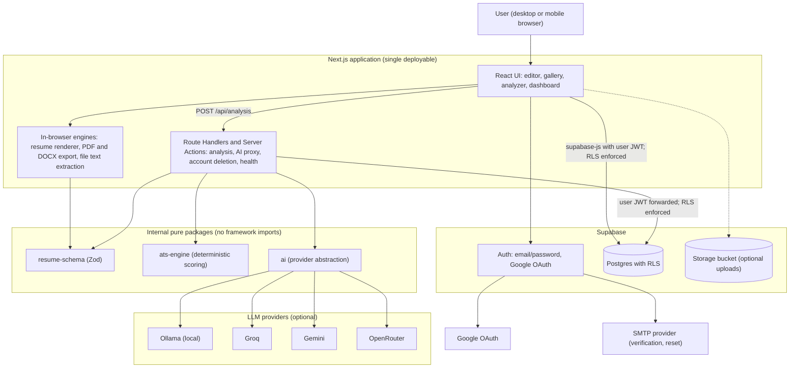

### 8.2 Key design rules

1. **Data path A (CRUD):** browser → Supabase with the *user's JWT*; **RLS is the authorisation layer**. No service-role key in the browser, ever.
2. **Data path B (analysis/AI):** browser → `/api/analysis` → deterministic engine → optional LLM through the provider abstraction → result saved under the user's identity. API keys exist only in server environment variables.
3. **Exports run in the browser.** No server cost, no server-side copy of the resume is created for export.
4. **The service-role key** is used in exactly one place: the account-deletion handler (and cleanup jobs), and never inside request handlers that act on a user's behalf otherwise.

### 8.3 Analysis pipeline (logical)

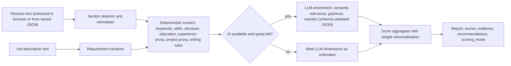

---

## 9. UI/UX Design Specification

### 9.1 Principles

1. **Content first.** The resume page is always the visual hero; chrome stays dark and quiet.
2. **No surprise gates.** Nothing the user built is hidden behind a paywall or a signup wall at export time (the central complaint about competitors [R]).
3. **Explain, don't just score.** Every number links to its evidence.
4. **Fast feedback.** Autosave indicator, preview within ~0.5 s, optimistic UI for list actions.
5. **Keyboard and screen-reader accessible**, with 4.5:1 contrast verified (§10.2).
6. **Restraint.** No decorative gradients; motion limited to 120 to 200 ms state transitions and respects `prefers-reduced-motion`.

### 9.2 Information architecture

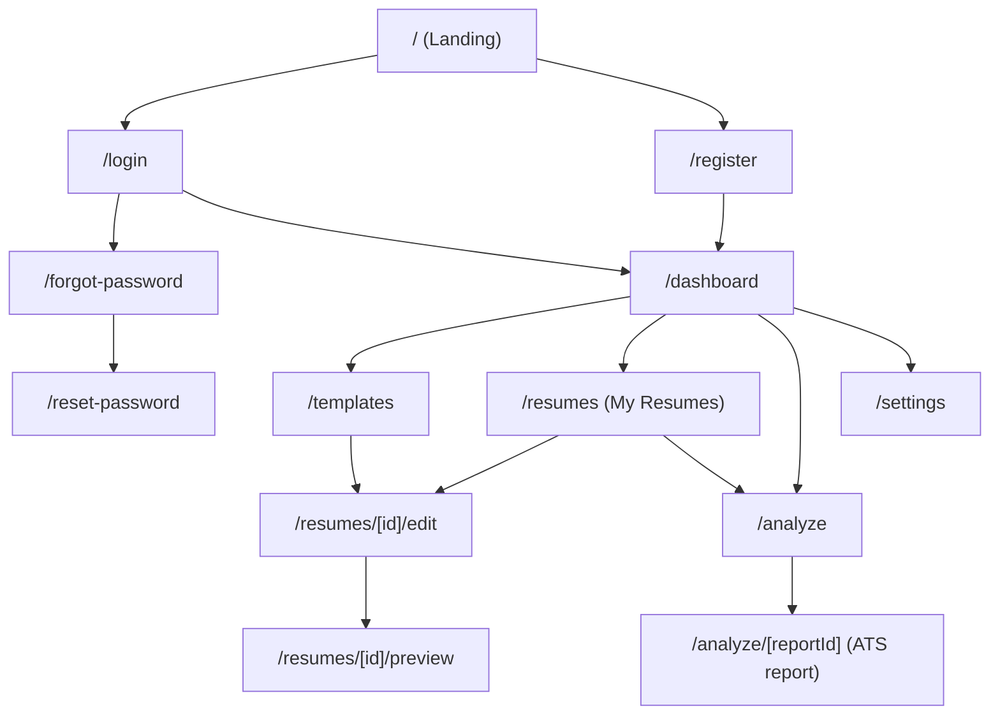

---

## 10. Design System

### 10.1 Color tokens (dark-only for MVP)

| Token | Hex | Use |
|---|---|---|
| `--bg-0` | `#0A0E17` | App background (charcoal navy) |
| `--bg-1` | `#0F1626` | Page sections, side panels |
| `--surface` | `#151D2E` | Cards, inputs, popovers (dark slate) |
| `--surface-2` | `#1C2640` | Hover and raised surfaces |
| `--border` | `#26324D` | Dividers, input borders (decorative) |
| `--border-strong` | `#3A4A6E` | Input borders that carry meaning (focus rings use accent) |
| `--text` | `#F4F7FB` | Primary text |
| `--text-muted` | `#9AA7BD` | Secondary text, labels |
| `--accent` | `#3B82F6` | Electric-blue accents, links, focus ring, icons |
| `--accent-strong` | `#2563EB` | **Primary button fill** (white text) |
| `--accent-hover` | `#4C8DFF` | Hover on accent text/links |
| `--success` | `#34D399` | Pass, matched keyword |
| `--warning` | `#FBBF24` | Warn, partial |
| `--danger` | `#F87171` | Fail, missing, destructive |

### 10.2 Contrast verification (computed, WCAG 2.x relative luminance)

| Pair | Ratio | WCAG AA (normal text 4.5:1) |
|---|---|---|
| `--text` on `--bg-0` | 17.96 | Pass |
| `--text` on `--surface` | 15.67 | Pass |
| `--text-muted` on `--bg-1` | 7.43 | Pass |
| `--text-muted` on `--surface` | 6.93 | Pass |
| `--text-muted` on `--surface-2` | 6.17 | Pass |
| `--accent` `#3B82F6` on `--bg-1` | 4.91 | Pass |
| `--accent` `#3B82F6` on `--surface` | 4.58 | Pass (narrow margin) |
| `--accent-hover` on `--surface` | 5.26 | Pass |
| White on `--accent-strong` `#2563EB` | 5.17 | Pass (button label) |
| White on `#2F6BFF` | 4.50 | Borderline: **not used for buttons** |
| `--success` / `--warning` / `--danger` on `--surface` | 8.76 / 10.09 / 6.09 | Pass |
| `--border` on `--bg-1` | 1.42 | Decorative only. Meaningful boundaries (input outlines) use `--border-strong` and must reach 3:1 for UI components; **re-verify in Phase 3** |

Never convey status by color alone; pair with icon and text.

### 10.3 Typography

- **UI:** Inter (SIL OFL), self-hosted via `@fontsource`. **Mono:** JetBrains Mono for code-like chips.
- **Scale (rem):** 12 / 14 / 16 (base) / 18 / 20 / 24 / 30 / 36 / 48. Line heights 1.5 body, 1.2 headings. Weights 400, 500, 600.
- **Resume fonts (export-safe, open licences):** Inter, Lato, Open Sans, Roboto, Source Sans 3, Source Serif 4, Merriweather, IBM Plex Sans/Serif. Each must be bundled as TTF/WOFF for the PDF renderer.

### 10.4 Spacing, radius, elevation, motion

- **Spacing:** 4-px base: 4, 8, 12, 16, 24, 32, 48, 64. Page gutters 16 (mobile) / 24 (tablet) / 32 (desktop). Max content width 1200 px (marketing), app uses full width.
- **Radius:** 6 (inputs/buttons), 10 (cards), 16 (modals).
- **Elevation:** borders first, shadows rarely (`0 8px 24px rgba(0,0,0,.4)` only for popovers/modals).
- **Motion:** 120 ms (hover), 180 ms (panel/slide), ease-out; no parallax or looping animation; skeletons instead of spinners for lists.
- **Breakpoints:** `sm 640`, `md 768`, `lg 1024`, `xl 1280`.

### 10.5 Component standards

| Component | Standard |
|---|---|
| Button | Variants: primary (accent-strong fill), secondary (surface + border), ghost, destructive. Sizes 32/40/48. Min touch target 44×44 on touch devices. Loading state shows spinner **and** keeps the label |
| Input / Textarea | 40 px high, `--surface` fill, `--border-strong` outline, 2 px accent focus ring with 2 px offset; visible label always (placeholder is never the label); inline error text with icon |
| Select / Combobox | Radix-based, keyboard searchable |
| Card | `--surface`, `--border`, radius 10, hover raises to `--surface-2` |
| Toast | Bottom-right (top on mobile), polite live region, 5 s, undo action where applicable |
| Dialog | Focus trap, ESC closes, returns focus, destructive dialogs name the object being destroyed |
| Score ring / bar | Value + label + status icon, color is secondary cue; `role="img"` with text alternative |
| Badge/chip | Matched keyword (success), missing (danger), optional (neutral) |
| Skeleton | Used for resume cards and report |
| Empty state | Illustration-free: icon, one sentence, one primary action |

### 10.6 Interaction guidelines

- Destructive actions are reversible when possible (Trash with 30-day restore, as RR does [V]); otherwise confirm by name.
- Autosave is silent; the status chip shows `Saving…` → `Saved 12:04` → `Offline, will retry`.
- Drag handles have a keyboard alternative (move up/down buttons, `Space` to lift, arrows to move).
- Forms validate on blur and on submit, never on every keystroke for email/password.
- Focus is always visible; skip-to-content link on every page.

---

## 11. Application Pages

Common shell for authenticated pages: left rail (≥ `lg`) or bottom tab bar (< `lg`) with Dashboard, My Resumes, Templates, Analyzer, Settings; top bar with account menu.

### 11.1 Landing Page (`/`)
- **Purpose:** explain value, build trust, convert to sign-up.
- **Components:** sticky header (logo, links, Log in, primary **Get started**), hero (headline, sub-line, CTA, product screenshot), "How it works" 3 steps, template strip, "Transparent ATS analysis" section with a sample score breakdown, honest-pricing/free statement, FAQ, footer (privacy, terms, contact).
- **Layout:** single column, 12-col grid at `lg`; hero 2-column at `lg`, stacked below.
- **Navigation:** anchors + Login/Register; authenticated visitors see "Go to dashboard".
- **Interactions:** CTA → `/register`; template strip → `/register?next=/templates`.
- **Responsive:** header collapses to a sheet menu < `md`; hero image below text.

### 11.2 Login (`/login`)
- **Purpose:** authenticate. **Components:** logo, email, password (show/hide), **Continue with Google**, "Forgot password?", link to register, inline error region.
- **Layout:** centered 400-px card on `--bg-1`. **Navigation:** success → `next` param or `/dashboard`.
- **Interactions:** Enter submits; failed attempts show a generic "Invalid email or password"; after repeated failures show the rate-limit message from the server.
- **Responsive:** card goes full-width < `sm`.

### 11.3 Registration (`/register`)
- **Purpose:** create account. **Components:** name, email, password (strength hint, min 8, no composition rules but breach-awareness copy), confirm via email, Google button, terms/privacy consent.
- **Interactions:** after sign-up, "Check your email" screen with resend (rate-limited). Google flow skips verification.
- **Responsive:** as login.

### 11.4 Forgot Password (`/forgot-password` → `/reset-password`)
- **Purpose:** recover access. **Components:** email field → neutral confirmation ("If that address has an account, we sent a link"); reset page with new password + confirm.
- **Rule:** the response never reveals whether the email exists.

### 11.5 User Dashboard (`/dashboard`)
- **Purpose:** the home hub. **Components:** greeting; quick actions (New resume, Analyze a resume); recent resumes (4 cards with thumbnail, name, edited-at); latest ATS reports (3 rows with score); empty state for new users with a 3-step checklist.
- **Layout:** two-column at `lg` (main + sidebar of recent reports), single column below.
- **Interactions:** card click opens editor; kebab menu = rename / duplicate / delete.

### 11.6 Resume Template Gallery (`/templates`)
- **Purpose:** choose a design. **Components:** filter chips (single-column, two-column, modern, classic, ATS-simple), grid of template cards with live-rendered thumbnails, "Use this template" and "Preview with sample data".
- **Layout:** responsive grid 1/2/3/4 columns. **Interactions:** hovering a card shows a larger preview; selecting creates a resume then routes to the editor. The same gallery opens as a dialog inside the editor for **switching** templates (data preserved).

### 11.7 Resume Editor (`/resumes/[id]/edit`): see §11.7.1.

### 11.8 Resume Preview (`/resumes/[id]/preview`)
- **Purpose:** distraction-free full-page view and export hub. **Components:** paginated pages, zoom/fit controls, page navigator, download menu (PDF, DOCX, JSON), "Back to editor", "Analyze this resume".
- **Responsive:** pinch-zoom and horizontal swipe between pages on touch.

### 11.9 AI Resume Analyzer (`/analyze`)
- **Purpose:** collect inputs. **Components:** resume source tabs (**My resumes** selector | **Upload PDF/DOCX** drop zone | **Paste text**), job description textarea with character counter and optional job title/company, privacy note ("Your uploaded file is read in your browser and is not stored"), AI toggle showing quota remaining ("2 of 3 AI analyses left today"), **Analyze** button.
- **Interactions:** upload runs extraction in a Web Worker, shows detected sections for confirmation; validation errors inline (file too big, wrong type, no text found).
- **Responsive:** two columns (resume | JD) at `lg`; stacked below.

### 11.10 ATS Analysis Report (`/analyze/[reportId]`)
- **Purpose:** results and next steps. **Components:** overall score ring + `scoring_mode` badge (*Deterministic* / *Hybrid*) + disclaimer, dimension cards (score, weight, "How this was calculated" expander with evidence), keyword table (matched / missing / optional with where-found), issues list grouped by severity, prioritised recommendations with expected impact, section-by-section findings, re-run button, "Open in editor" deep links to the exact field, export report (PDF/JSON), delete report.
- **Layout:** sticky score summary left (`lg`), scrolling detail right.
- **Responsive:** summary becomes a top card; tabs: Overview | Keywords | Issues | Fixes.

### 11.11 My Resumes (`/resumes`)
- **Purpose:** manage. **Components:** search, sort (edited, name, created), view toggle (grid/list), card/row with thumbnail, name, template, last edited, ATS score badge if analyzed; actions: Open, Rename, Duplicate, Export, Move to Trash; Trash tab with restore; bulk select.
- **Responsive:** list view on phones; actions in a bottom sheet.

### 11.12 Account Settings (`/settings`)
- **Purpose:** profile, security, data. **Components:** Profile (name, avatar optional), Email and password (change, sign out other sessions), Connected accounts (Google link/unlink), Preferences (default template, page size, locale-free for MVP), Data (export all as JSON, delete analysis history), **Danger zone** (delete account, type email to confirm).
- **Responsive:** tabs → accordion on phones.

### 11.7.1 Resume Editor specification

**Layout (≥ `xl`): three resizable panes**

```
┌────────────┬───────────────────────────────┬──────────────────┐
│ LEFT       │ CENTER                        │ RIGHT            │
│ Edit panel │ Live preview (paged canvas)   │ Style panel      │
│ sections,  │ zoom 60–150% / Fit width      │ Template / Type  │
│ entries,   │ page navigator                │ Color / Spacing  │
│ reorder    │                               │ Page / Check     │
└────────────┴───────────────────────────────┴──────────────────┘
 Top bar: back · resume name (inline rename) · save status · undo/redo · Analyze · Download ▾
```

Resizable via a splitter (`react-resizable-panels`-style); widths persist per user.

| Area | Specification |
|---|---|
| **Left editing panel** | Accordion of sections in current order; each header has drag handle, visibility eye, entry count. Entry cards (draggable) open an inline form (zod-validated). Rich text restricted to bold/italic/bullets/links. "Add section" menu includes custom sections (text / entries / list / key-value). Inline hints ("Start with a strong verb"). Clicking text in the preview focuses the matching field (selection sync) |
| **Center preview** | Real rendered pages, double-buffered (§17). Zoom 60 to 150 % and Fit; page boundaries visible; a non-blocking badge shows "Spills onto page 3" if over the limit; "Updating…" appears only if render exceeds 600 ms and never blanks the page |
| **Right styling panel** | Tabs: **Template** (gallery dialog, current marked), **Typography** (heading font, body font, size 9 to 14 pt, line height 1.0 to 1.8, bold headings), **Color** (accent, heading, text, background; presets; custom hex with live contrast warning), **Spacing and layout** (section gap, item gap, margins 8 to 30 mm, columns 1 or 2 with sidebar width), **Page** (A4 / Letter, show page numbers), **Check** (live ATS lint: structure warnings, same `ats-engine` rules, click to jump) |
| **Template switching** | Changes only `template_id` + that template's default design tokens; content is untouched. A non-destructive confirm lists design values that will be reset; **Undo** available |
| **Section reordering** | Drag, or keyboard (focus handle, Space, arrows, Space). Single-column: vertical order. Two-column: sections can be moved between main and sidebar. Reordered state is part of `layout`, so it is undoable and versioned |
| **Font customization** | Curated open-licence list only (§10.3). Selecting a font loads only the needed weights; unavailable glyph fallback is flagged in Check |
| **Color customization** | Applies to resume tokens only (not UI). Background colors default to white; changing it shows a warning "Dark backgrounds often print and parse poorly" |
| **Page size and margins** | A4 default (India), Letter option; margins link/unlink top/right/bottom/left; warns below 12 mm (printer safe) and below 8 mm (RR uses 8 as ATS minimum [V]) |
| **Autosave** | Debounced 1.5 s after last change and on blur/visibility hide; saves `data` + `design` JSON with optimistic concurrency (`updated_at` compare); status chip; offline queue in memory with retry; `beforeunload` guard when dirty |
| **Undo / redo** | Zundo history (cap 100 states), `⌘/Ctrl+Z`, `⇧+⌘/Ctrl+Z`; history is session-local; named **version snapshots** (server) provide cross-session recovery; a restore creates a `before-restore` snapshot first (RR pattern [V]) |
| **Export** | Download menu: PDF, DOCX, JSON. PDF/DOCX are generated client-side; filename `Name_Role_YYYY-MM.pdf`; progress toast; failure shows reason and retry |
| **Mobile (< `lg`)** | One view at a time via bottom segmented control: **Edit | Preview | Style**. Preview is read-only with pinch-zoom. Drawer for style panel on tablets (pinned beside the page in landscape), like RR's tablet behaviour [V] |
| **Keyboard** | `⌘/Ctrl+S` force save, `⌘/Ctrl+K` command menu (add section, switch template, export), `⌘/Ctrl+Z/Y`, `Esc` closes dialogs |

---

## 12. User Workflow Diagrams

### 12.1 Workflow A: Registration

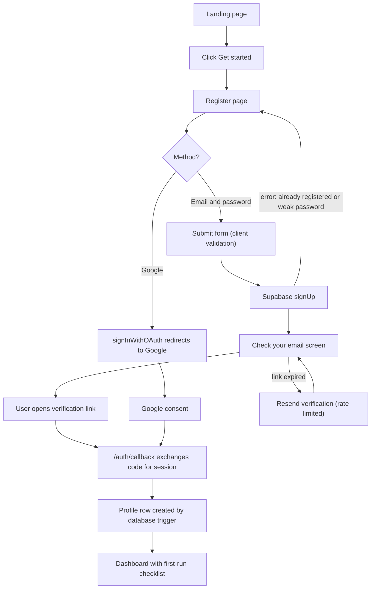

### 12.2 Workflow B: Create a resume

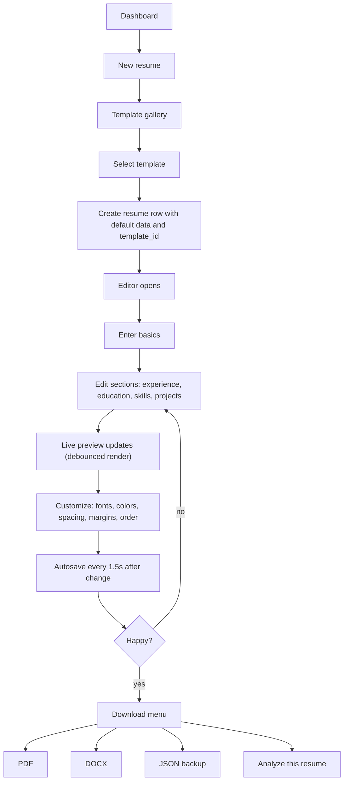

### 12.3 Workflow C: AI resume analysis

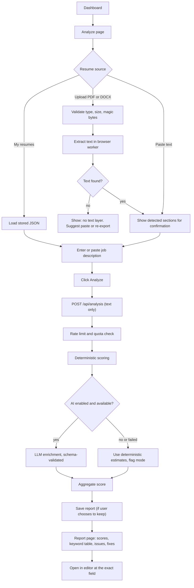

### 12.4 Workflow D: Resume management

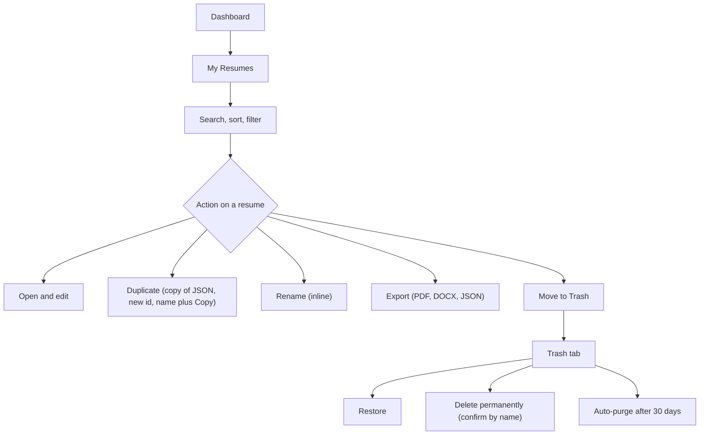

### 12.5 Auth and session sequence

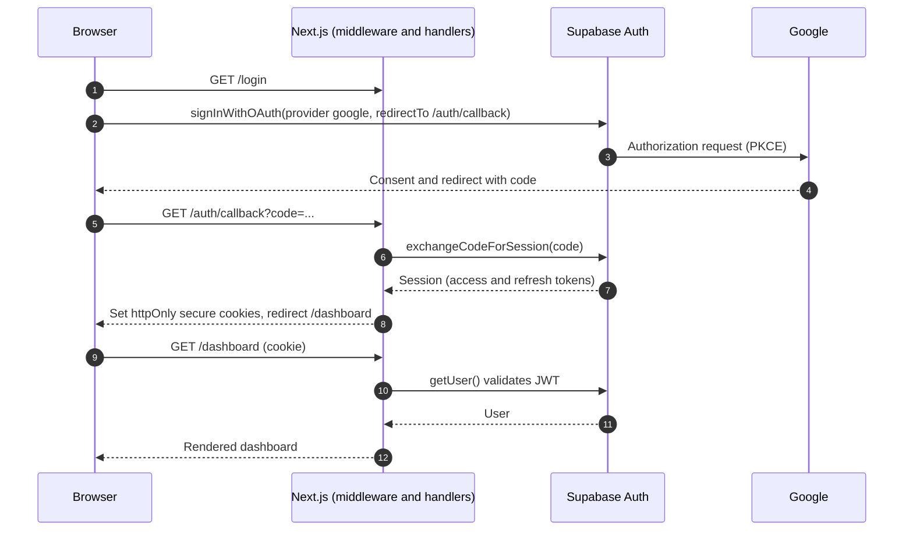

---

## 13. Database Architecture

### 13.1 Mapping from the brief's candidate tables

The brief asked to "avoid unnecessary tables". Result: **6 tables**, plus the built-in `auth.users`.

| Candidate in brief | Decision | Reason |
|---|---|---|
| `users` | Supabase `auth.users` (built-in) + `profiles` | Do not duplicate identity |
| `profiles` | **Kept** | Display name, preferences |
| `resumes` | **Kept** | Core entity; `content` and `design` are `jsonb` |
| `resume_sections` | **Removed** | Sections live in `resumes.content` (RR, CVAurum, CVTailor all do this [V]); a section table makes reorder/undo/versioning/atomic save much harder |
| `resume_templates` | **Removed** (code registry) | Templates are code (components + defaults). A table would need syncing with code on every deploy. `resumes.template_id` is validated against the registry |
| `resume_versions` | **Kept** | Cross-session recovery; same idea as RR's `resume_version` [V] |
| `ai_analysis_reports` | **Kept** as `analysis_reports` | Persisted results |
| `job_descriptions` | **Removed** (columns in report) | JD is always analysed together with a resume; reuse is a UI convenience (re-run from a report) |
| `user_preferences` | **Removed** (`profiles.preferences jsonb`) | A few settings; no need for a table |
| (new) `ai_usage` | **Added** | Per-user daily quota accounting |
| (new) `rate_limits` | **Added** | Fixed-window burst limiting (service-only). Alternative: Upstash Redis |

### 13.2 Entity-relationship diagram

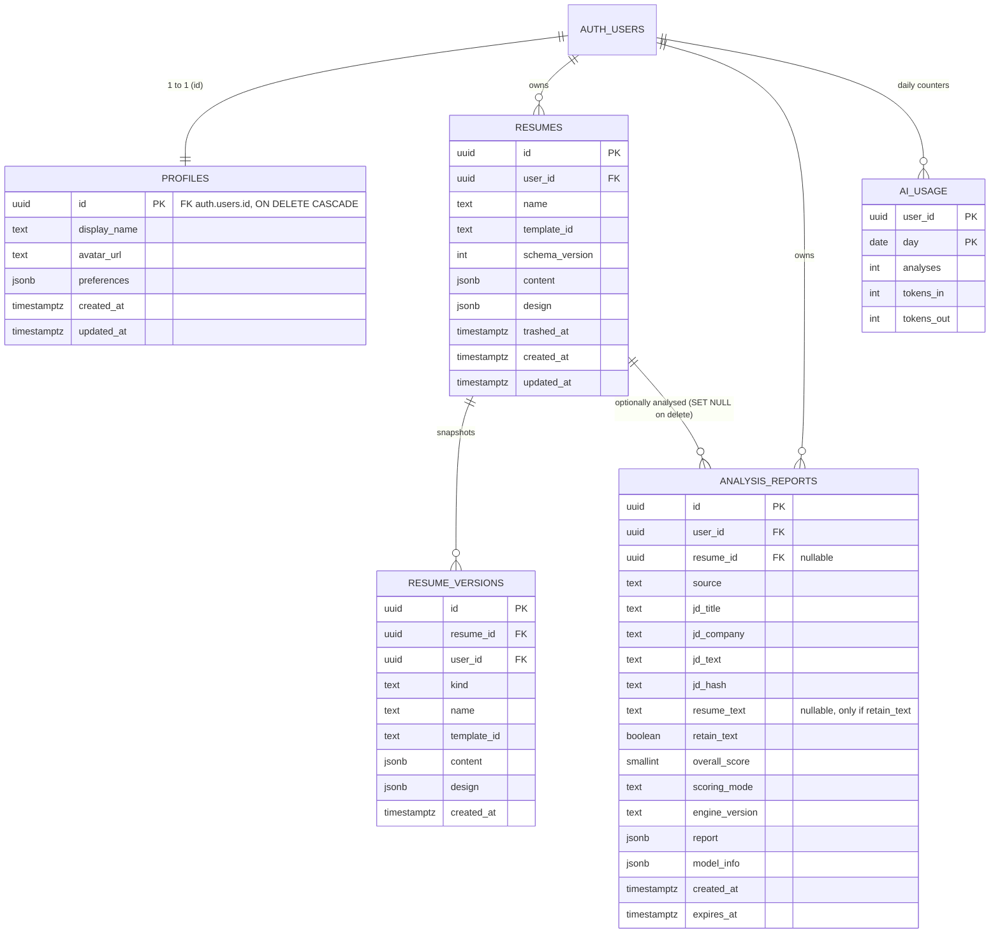

(`rate_limits` has no foreign keys and is omitted from the diagram.)

### 13.3 Table specifications

#### `profiles`
| Column | Type | Constraints |
|---|---|---|
| `id` | `uuid` | **PK**, **FK → auth.users(id) ON DELETE CASCADE** |
| `display_name` | `text` | `check (char_length(display_name) <= 80)` |
| `avatar_url` | `text` | nullable; taken from Google if present; no upload feature in MVP |
| `preferences` | `jsonb` | not null, default `'{}'`; validated by Zod on write (default template, page size, ai_enabled) |
| `created_at`, `updated_at` | `timestamptz` | default `now()` |

Created by a `SECURITY DEFINER` trigger on `auth.users` insert (with `set search_path = ''`). Index: PK only.

#### `resumes`
| Column | Type | Constraints |
|---|---|---|
| `id` | `uuid` | **PK**, default `gen_random_uuid()` |
| `user_id` | `uuid` | **FK → auth.users(id) ON DELETE CASCADE**, not null |
| `name` | `text` | not null, length 1 to 120 |
| `template_id` | `text` | not null (validated in app against registry) |
| `schema_version` | `int` | not null; drives forward migrations of `content` |
| `content` | `jsonb` | not null; `check (pg_column_size(content) < 262144)` (256 KB) |
| `design` | `jsonb` | not null; `check (pg_column_size(design) < 32768)` |
| `trashed_at` | `timestamptz` | nullable; purge after 30 days |
| `created_at`, `updated_at` | `timestamptz` | default `now()`; `updated_at` maintained by trigger |

Indexes: `(user_id, updated_at desc) where trashed_at is null` (list), `(trashed_at) where trashed_at is not null` (purge job). Security-relevant flags (none exist in MVP) must **not** be placed in `content` (RR lesson [V]).

#### `resume_versions`
| Column | Type | Constraints |
|---|---|---|
| `id` | `uuid` | **PK** |
| `resume_id` | `uuid` | **FK → resumes(id) ON DELETE CASCADE** |
| `user_id` | `uuid` | **FK → auth.users(id) ON DELETE CASCADE** (denormalised so RLS needs no join) |
| `kind` | `text` | `check (kind in ('auto','named','before-restore','restored','import'))` |
| `name` | `text` | nullable (for `named`) |
| `template_id`, `content`, `design` | | snapshot columns, same size checks |
| `created_at` | `timestamptz` | default `now()` |

Index: `(resume_id, created_at desc)`. Retention: keep the latest **10** `auto` per resume plus up to **10** `named` (cap chosen from the storage maths in §23.4); an autosave snapshot is refreshed at most every 10 minutes within a session.

#### `analysis_reports`
| Column | Type | Constraints |
|---|---|---|
| `id` | `uuid` | **PK** |
| `user_id` | `uuid` | **FK → auth.users(id) ON DELETE CASCADE** |
| `resume_id` | `uuid` | **FK → resumes(id) ON DELETE SET NULL**, nullable |
| `source` | `text` | `check (source in ('stored','upload','paste'))` |
| `jd_title`, `jd_company` | `text` | nullable, length ≤ 160 |
| `jd_text` | `text` | not null, length ≤ 20,000 |
| `jd_hash` | `text` | not null (SHA-256 of normalised JD; cache key for requirement extraction) |
| `resume_text` | `text` | nullable; **only populated when `retain_text = true`**; length ≤ 60,000 |
| `retain_text` | `boolean` | default `false` |
| `overall_score` | `smallint` | `check (overall_score between 0 and 100)` |
| `scoring_mode` | `text` | `check (scoring_mode in ('deterministic','hybrid'))` |
| `engine_version` | `text` | not null (so old reports stay interpretable) |
| `report` | `jsonb` | not null; dimension scores, evidence, recommendations (§16.5) |
| `model_info` | `jsonb` | nullable: `{provider, model, latency_ms, tokens_in, tokens_out}`; **never the prompt or content** |
| `created_at` | `timestamptz` | default `now()` |
| `expires_at` | `timestamptz` | default `now() + interval '90 days'` |

Indexes: `(user_id, created_at desc)`, `(resume_id)`, `(expires_at)` for purge. Note that `report.evidence` contains short quoted excerpts of the resume even when `retain_text = false`; the UI must say so.

#### `ai_usage`
`PK (user_id, day)`; `analyses int`, `tokens_in int`, `tokens_out int`. Incremented by a `SECURITY DEFINER` function called from the server handler. Users may `select` their own row (to show remaining quota); no client writes.

#### `rate_limits`
`PK (key, window_start)`; `count int`. Keys like `analysis:user:<uuid>` or `analysis:ip:<hash>`. RLS enabled with **no policies** (service role only). Purged hourly. Fixed-window is coarse (allows up to 2× burst at a window edge); acceptable for MVP.

### 13.4 Row Level Security (specification)

RLS is **enabled on every table**; the default is deny. Policy SQL below is illustrative documentation, not a migration.

```sql
-- profiles
create policy "own profile read"   on profiles for select using ( id = (select auth.uid()) );
create policy "own profile update" on profiles for update
  using ( id = (select auth.uid()) ) with check ( id = (select auth.uid()) );
-- no insert policy (trigger creates); no delete policy (cascade from auth.users)

-- resumes
create policy "own resumes read"   on resumes for select using ( user_id = (select auth.uid()) );
create policy "own resumes insert" on resumes for insert with check ( user_id = (select auth.uid()) );
create policy "own resumes update" on resumes for update
  using ( user_id = (select auth.uid()) ) with check ( user_id = (select auth.uid()) );
create policy "own resumes delete" on resumes for delete using ( user_id = (select auth.uid()) );

-- resume_versions: select / insert / delete own; no update (immutable snapshots)
-- analysis_reports: select / insert / delete own; no update
-- ai_usage: select own only
-- rate_limits: no policies
```

Notes: (0) Supabase's RLS guidance **[V]** ([docs](https://supabase.com/docs/guides/database/postgres/row-level-security)): enable RLS on every table in an exposed schema; adding policies does **not** remove default role grants, so also `revoke` default grants from `anon`/`authenticated` and grant back only what each role needs; write one policy per operation; index every column used in a policy (a column counts as indexed only when it is the *leading* column of a btree index, so the composite PK `(user_id, day)` of `ai_usage` covers `user_id`); set `search_path = ''` on every `security definer` function and keep such functions out of exposed schemas; test with pgTAP under `supabase/tests/`, run by `supabase test db`. (1) every policy column (`user_id`) is indexed or is a PK; (2) `UPDATE` always has both `using` and `with check` so a user cannot reassign a row to someone else; (3) the `(select auth.uid())` form lets Postgres cache the call per statement (Supabase guidance **[V]**, valid because the result does not depend on row data); (4) never use `user_metadata` in policies, since signed-in users can edit it; authorization data belongs in `app_metadata` **[V]**; (5) Phase 2 must include **automated RLS tests**: with two test users, assert user B cannot select/update/delete/insert-as user A on every table.

**Storage (only if the "keep original file" option is built):** private bucket `resume-uploads`, object path `<user_id>/<uuid>`, policy `(storage.foldername(name))[1] = (select auth.uid())::text`, 5 MB limit, allowed MIME `application/pdf` and the DOCX MIME type, 30-day expiry. **Default MVP: no bucket in use.**

### 13.5 Data retention

| Data | Default retention | User control |
|---|---|---|
| Uploaded resume **file** | **Not stored** (read in browser) | Optional keep (off), 30 days |
| Extracted resume text | Not stored unless `retain_text` | Toggle per analysis |
| Analysis reports | 90 days (`expires_at`) | Delete any time; "Keep" extends |
| Resume versions | ≤ 10 auto + ≤ 10 named per resume | Delete any |
| Trashed resumes | 30 days then purged | Restore or purge now |
| AI usage counters | 90 days | None (aggregate only) |
| Account data | Until account deletion | Delete account → cascades; verified by test |
| Server logs | ≤ 14 days, no resume/JD content | n/a |

A scheduled job (`pg_cron` on Supabase **[P: confirm availability on free tier]**, otherwise a Vercel cron or a GitHub Actions schedule calling a protected endpoint) performs purges.

---

## 14. API Inventory

Principle: **do not write an API for what Supabase already provides under RLS.** Only operations that need secrets, quotas, or multi-step server logic get a route.

### 14.1 Application endpoints (Next.js Route Handlers)

| # | Name | Method / path | Purpose | Input | Output | AuthN | AuthZ | Errors |
|---|---|---|---|---|---|---|---|---|
| A1 | Auth callback | `GET /auth/callback` | Exchange OAuth/email-link `code` for a session; set cookies | query `code`, `next` (relative path only) | 302 redirect | none (PKCE code) | n/a | invalid/expired code → redirect `/login?error=auth`; `next` must be same-origin path (open-redirect guard) |
| A2 | Run analysis | `POST /api/analysis` | Deterministic scoring plus optional LLM; save report | JSON: `{ source: 'stored'\|'upload'\|'paste', resumeId?, resumeText?, jdText, jdTitle?, jdCompany?, useAi, retainText }` (Zod) | `200 { reportId, report }` | **Required** (session cookie) | `resumeId` must belong to caller (read through RLS client); quota and rate limits | `400` schema; `401`; `413` text too large; `422` unreadable/too short; `429` with `Retry-After` and `limit` kind (burst, daily-ai); AI failure → **200** with `scoring_mode: 'deterministic'` and warning, never `5xx` for AI problems; `500` generic id only |
| A3 | Delete account | `POST /api/account/delete` | Remove auth user and all data (service-role) | `{ confirmEmail }` | `204` | **Required** + recent sign-in (≤ 5 min) | caller can delete only self | `400`, `401`, `403` stale session, `500` |
| A4 | Health | `GET /api/health` | Liveness; light DB ping (also prevents free-project pause when called by an uptime monitor) | none | `{ status: 'ok' }` | none | none (no details leaked) | `503` if DB ping fails |
| A5 | Purge job | `POST /api/internal/purge` | Delete expired reports, old trash, rate-limit rows | header `Authorization: Bearer <CRON_SECRET>` | `{ deleted: {...} }` | secret | secret only | `401` |

### 14.2 Data operations via Supabase (PostgREST under RLS, no custom route)

| Operation | Via | Notes |
|---|---|---|
| List/create/read/update/duplicate/rename/trash/restore/delete resume | `supabase-js` `from('resumes')` | Update uses optimistic concurrency: `.update(...).eq('id', id).eq('updated_at', lastSeen)`; 0 rows → conflict toast |
| Create/list/restore/delete version | `from('resume_versions')` | Restore = insert `before-restore` snapshot, then update resume |
| List/read/delete reports | `from('analysis_reports')` | |
| Read profile / update preferences | `from('profiles')` | |
| Read remaining AI quota | `from('ai_usage')` (own row) | |

### 14.3 Auth operations (Supabase Auth SDK)

`signUp`, `signInWithPassword`, `signInWithOAuth({provider:'google'})`, `resetPasswordForEmail`, `updateUser({password})`, `resend`, `signOut({scope})`, `getUser`, `onAuthStateChange`, `linkIdentity` / `unlinkIdentity`.

### 14.4 Intentionally *not* built (MVP)

Public share endpoints, webhooks, a generic `/api/ai` proxy (AI is reached only through A2), export endpoints (exports are client-side), admin APIs, GraphQL.

### 14.5 Cross-cutting API rules

All inputs are validated with Zod at the boundary; responses use a uniform `{ error: { code, message, requestId } }`; no stack traces; CORS same-origin only; every handler resolves the user with `supabase.auth.getUser()` (network-verified) or `getClaims()` (signature-verified). **Never** `getSession()` for authorization in server code, because the cookie is forgeable (Supabase docs **[V]**, [SSR guide](https://supabase.com/docs/guides/auth/server-side/nextjs)); a request-size cap (`1 MB` body) is enforced.

---

## 15. External Integrations

| Integration | Role | SDK / interface | Secrets (server only unless noted) | Free-tier note |
|---|---|---|---|---|
| **Supabase** (Auth, Postgres, Storage) | Identity, data, optional files | `@supabase/supabase-js`, `@supabase/ssr` | `NEXT_PUBLIC_SUPABASE_URL`, `NEXT_PUBLIC_SUPABASE_ANON_KEY` (public by design; safe only because of RLS), `SUPABASE_SERVICE_ROLE_KEY` (server only) | §23 |
| **Google OAuth** | "Continue with Google" | Configured in Supabase dashboard; Google Cloud OAuth client | Client ID/secret held in Supabase | Free; uses basic `openid email profile` scopes only. Configure consent screen, authorised redirect URI = Supabase callback **[P]** |
| **SMTP provider** | Verification and reset emails | Supabase custom SMTP | SMTP credentials in Supabase | Supabase's default mailer allows **2 messages/hour, team members only, best-effort** and is "not meant for production use"; a new custom SMTP setup starts at **30 messages/hour** until raised **[V]** ([docs](https://supabase.com/docs/guides/auth/auth-smtp)). Choose a provider with a free tier; its limits were **not researched**, so verify in Phase 2 (D2) |
| **LLM providers** | Optional enrichment | Vercel AI SDK: `ai`, `@ai-sdk/groq`, `@ai-sdk/google`, `@ai-sdk/openai-compatible` (OpenRouter, Ollama OpenAI-compatible endpoint), `ollama` | `GROQ_API_KEY`, `OLLAMA_BASE_URL` (later and conditionally: `GEMINI_API_KEY` for a *paid* project, `OPENROUTER_API_KEY`) | §7.4 |
| **Hosting** (Vercel Hobby, or alternatives) | Run the Next.js app | Git integration | Platform env vars | **Hobby is restricted to non-commercial personal use [V]** ([Vercel fair use](https://vercel.com/docs/limits/fair-use-guidelines)); §22, §23 |
| **Fonts** | Resume and UI fonts | `@fontsource/*` (self-hosted, no Google Fonts request) | none | Free, OFL/Apache |
| **Uptime monitor** | Pings `/api/health` (also keeps Supabase awake) | HTTP | none | Free tiers exist; verify |
| **Error monitoring** (optional) | Exceptions without PII | Sentry-style SDK | DSN | Verify free quota; scrub request bodies |

---

## 16. AI Architecture

### 16.1 Design goals

1. **Deterministic core:** a pure TypeScript package (`ats-engine`) with no network, no LLM, no framework imports. The same input always yields the same report (given the same `engine_version`).
2. **LLM is an enhancer, behind an interface:** failure, timeout, quota or "AI off" never blocks a report.
3. **Explainability:** every score carries `inputs`, `formula_id`, `contributions[]`, `evidence[]`.
4. **Privacy:** resume text goes to a third-party LLM only if the user enabled AI for that run; the UI states which provider.
5. **Cost control:** per-user daily quota, caching by `jd_hash`, small prompts, small models.

### 16.2 Pipeline (maps to the brief's 12 requirements)

| # | Requirement | Where | Method |
|---|---|---|---|
| 1 | Extract resume content | Browser worker | `pdfjs-dist`/`unpdf` for PDF (text items re-assembled into lines by geometry, as RR's `pdf-lines.ts` does [V]); `mammoth` for DOCX; paste as-is |
| 2 | Identify sections | Engine | Heading detection (short lines, caps/bold cues, colon, vertical gaps) matched against a **section alias dictionary** (e.g., "Work History", "Professional Experience" → `experience`), RR's `section-aliases.ts` is the model [V] |
| 3 | Extract job requirements | Engine | Split JD into sentences and bullets; tag by cue words (`must`, `required`, `minimum`, `X+ years`, `preferred`, `nice to have`, `bonus`); detect years, degree, certifications, seniority/title |
| 4 | Required vs optional skills | Engine | Taxonomy lookup on each tagged line; section headings ("Requirements" vs "Preferred") override sentence cues; default = required when ambiguous (conservative) |
| 5 | Compare resume skills | Engine | Canonicalise via alias map (`js`→JavaScript, `k8s`→Kubernetes, `postgres`→PostgreSQL), lemma match, exact n-gram; credit by **where** it appears (§16.4) |
| 6 | Missing keywords | Engine | Required/preferred terms with zero credit, ranked by importance; each with a suggested placement section |
| 7 | Experience relevance | Engine (+LLM) | §16.4 E |
| 8 | Project relevance | Engine (+LLM) | §16.4 P |
| 9 | Education and certs | Engine | §16.4 D |
| 10 | Readability and formatting | Engine | Rule catalog (§16.4 R). For generated resumes also reads `design` (font size, margins, columns); for uploads, only extraction-quality signals |
| 11 | Grammar and writing | Engine rules (+LLM) | §16.4 W |
| 12 | Recommendations | Engine (+LLM wording) | Rule → recommendation templates, ranked by estimated points gained × effort; LLM may rephrase and produce example rewrites |

**Skills taxonomy.** A curated, versioned JSON file (`skills.v1.json`: canonical name, aliases, category, related terms) built from our own list. If an external dataset is considered (e.g., ESCO, O*NET), **verify its licence before bundling** (not verified in Phase 1).

### 16.3 Is the proposed scoring model technically reasonable?

The brief's weights: Keyword 20, Skills 20, Experience 20, Projects 15, Education/Certs 10, Structure 10, Grammar 5 (sum 100).

**Verdict: a reasonable starting prior, but not shippable as-is.** Findings:

| # | Problem | Why it matters | Recommendation |
|---|---|---|---|
| 1 | **Double counting.** Most "keywords" in a JD *are* skills; Keyword (20) and Skills (20) measure largely the same overlap | A missing skill is penalised twice, inflating variance | Define Keywords as **non-skill terms** (domain vocabulary, responsibilities, methodologies, titles) and Skills as **taxonomy hard skills/tools**; exclude taxonomy skills from the keyword set |
| 2 | **Dimensions that do not apply.** Projects (15) is meaningless for a senior non-technical profile; Education (10) is meaningless when the JD states no requirement | Fixed weights punish good resumes | Mark a dimension `not_applicable` and **renormalise** the remaining weights; show it in the report |
| 3 | **Mixed constructs.** Structure and Grammar describe the *document*, not the *fit*. A beautifully formatted irrelevant resume would earn ~15 points free | Overall score implies fit that is not there | Report two headline numbers: **Job Match** and **ATS Readiness**; combine as a documented weighted average |
| 4 | **Un-scorable without an LLM.** Experience *relevance* and Project *relevance* are semantic; Grammar needs a language model for reliability | Offline mode would silently lie | Always compute a deterministic proxy, label it **estimated**, and set `scoring_mode` accordingly. LLM adjusts within a bounded range (±15 points of proxy) so a hallucination cannot swing the score |
| 5 | **No validation.** Nothing in the brief or in the reference repos shows these weights are calibrated to real hiring outcomes | Risk of false precision. An independent review calls a competitor's score "oversold" [R] | Calibrate against a labelled set (≥ 40 resume/JD pairs rated by 2+ humans); report Spearman correlation; publish limitations. Until then show **bands** (Strong ≥ 80 / Moderate 60 to 79 / Weak < 60) beside the number |
| 6 | **Gameable.** Keyword stuffing | Encourages bad resumes | Skills found *only* in a skills list earn partial credit (0.6); detect repeated-term stuffing; reward evidence in experience bullets |
| 7 | **JD quality.** A 40-word JD yields little signal | Misleading confidence | Output `confidence` (low/med/high) from JD length, number of extracted requirements and extraction quality |
| 8 | **Parse failure should dominate.** If text cannot be extracted, nothing else is trustworthy | Misleading partial scores | Hard gate: no extractable text → no score, explain; critical contact-info failures cap Readiness |

**Recommended v1 model**

```
Job Match  = renormalised weighted mean of:
    Skills alignment      30
    Experience relevance  30
    Keyword coverage      20   (non-skill terms only)
    Project relevance     10   (N/A → redistributed)
    Education/certs       10   (N/A → redistributed)

ATS Readiness = 0.70 * Structure & parse health
              + 0.30 * Writing quality

Overall = 0.80 * Job Match + 0.20 * ATS Readiness
```

Effective weights when all dimensions apply: Skills 24, Experience 24, Keywords 16, Projects 8, Education 8, Structure 14, Writing 6, close to the brief's emphasis but without double counting. The original weights remain selectable (`weights_profile = "brief-v0"`) so both can be compared on the calibration set. **Weights are configuration, versioned with `engine_version`; they are not hard-coded in scorers.**

### 16.4 Dimension formulas (how each score is obtained)

All dimension scores are 0 to 100. Terms: `m(t)` = match credit of term *t*; `w(t)` = importance weight.

**Match credit `m(t)`** (shared): `1.0` if the term (or alias/lemma) appears in an experience or project bullet (demonstrated); `0.6` if it appears only in Skills/Summary (claimed); `0.0` if absent.

**Importance `w(t)`**: required = 1.0, preferred = 0.5; ×1.25 if the term appears in the job title or the first requirements heading; + up to 0.5 for frequency in JD (`min(freq,3)/6`).

| Dim | Formula | Evidence recorded |
|---|---|---|
| **Skills (S)** | `100 × Σ w(t)·m(t) / Σ w(t)` over taxonomy skills in the JD | per-skill: required/preferred, credit, where found (quote ≤ 140 chars), missing list |
| **Keywords (K)** | same formula over non-skill terms (noun phrases surviving stop-list, TF-IDF-ranked vs a general corpus, top 25) | per-term table |
| **Experience (E)** | `E_det = 100 × (0.4·titleSim + 0.4·bulletSim + 0.2·yearsFit)`; `titleSim` = token-set similarity of target title to held titles (recent roles ×1, older than 5 years ×0.6); `bulletSim` = BM25-style cosine between JD responsibilities and experience bullets; `yearsFit = min(1, years_held / years_required)` (1 if no requirement). Hybrid: `E = E_det + clamp(E_llm − E_det, −15, +15)` | years computed from parsed dates, matched bullets, top-3 most/least relevant roles |
| **Projects (P)** | `100 × (0.5·techOverlap + 0.5·bulletSim)` on project entries; `N/A` if no projects section **and** JD does not mention projects; hybrid bounded the same way | per-project score |
| **Education/Certs (D)** | `degreeFit` (ordinal: diploma < bachelor < master < doctorate; "or equivalent experience" lowers the bar) 60%, `fieldFit` (fuzzy token match to named fields) 20%, `certFit` (required certs found) 20%; `N/A` if JD states no education/cert requirement | requirement text, found text |
| **Structure & parse health (R)** | Start 100; subtract per finding: error −15, warning −5, info −1 (floor 0); catalogue modelled on RR's `ATS_RULE_CATALOG_V1` severities [V]: missing name/email, malformed email/URL, missing phone, unparseable/reversed/empty dates, picture present, non-standard headings, very long bullets (> 35 words) or very short (< 5), > 2 pages, font < 9 pt, line-height < 1.15, margins < 8 mm (RR's constants [V]), extraction anomalies (letter-spaced text, interleaved columns, private-use glyphs) | rule id, severity, location pointer, fix |
| **Writing (W)** | Rule-based: action-verb start ratio, quantification ratio (digits/%/currency), first-person pronouns, passive-voice heuristic, filler/weak phrases, repeated openers, tense consistency per role, bullet-length distribution; `W = 100 × weighted mean`. Hybrid adds LLM grammar findings count as a bounded penalty | counts and offending bullets |

**Reproducibility.** Each dimension emits `formula_id` (e.g., `S.v1`), the numeric `inputs`, and `contributions[]` that sum exactly to the dimension score. A unit test asserts that the displayed explanation reproduces the number.

### 16.5 Report schema (shape)

```
Report {
  engine_version, weights_profile, scoring_mode: 'deterministic' | 'hybrid',
  confidence: 'low' | 'medium' | 'high',
  overall: { score, band, jobMatch, atsReadiness },
  dimensions: [{ id, label, score|null, applicable, weight_effective,
                 estimated: boolean, formula_id, inputs, contributions[],
                 evidence[], explanation }],
  keywords: { matched[], missing[], optionalMissing[] },
  issues:   [{ rule_id, severity, pointer, message, fix }],
  recommendations: [{ id, title, why, impact_points, effort, target_pointer }],
  disclaimers: [...]
}
```

### 16.6 Provider abstraction

```
interface AiProvider {
  id: 'ollama' | 'groq' | 'gemini' | 'openrouter';
  isAvailable(): Promise<boolean>;                        // config present, health ok
  generateObject<T>(args: { schema: ZodType<T>; system: string; prompt: string;
                            maxOutputTokens: number; timeoutMs: number }): Promise<{ data: T; usage }>;
}
```

- **Data-protection rule: no provider whose terms allow training on, or human review of, submitted content may receive resume or JD text.** This rules out Gemini's unpaid tier **[V]** and any provider not yet reviewed.
- Implemented with the Vercel AI SDK `generateObject` (schema-constrained JSON), as RR does through `packages/ai` [V]. A **router** tries providers in a configured order (default `AI_PROVIDER_ORDER=groq` in cloud, `ollama` locally; Gemini only on a paid-tier project, OpenRouter only after data-policy verification), with a per-call timeout (20 s), one retry on 5xx/timeout, **no retry on 429** (jump to the next provider or degrade), and a circuit breaker per provider (open for 60 s after 3 failures).
- The router is the only code that reads provider keys. Components never import provider SDKs.
- **Prompt-injection posture.** Resume and JD are *untrusted data*: they are placed inside clearly delimited blocks, the system prompt states they may contain instructions that must be ignored, output is **schema-constrained and bounded** (score deltas clamped, text length capped), and nothing the model returns is executed, rendered as HTML, or used to build queries. Strings from the model are escaped on render.
- **Prompts are versioned** (`prompts/<name>.v1.ts`) and covered by golden tests on a stub provider.
- **Evaluation harness (Phase 6):** 20 resume/JD pairs × candidate models; metrics = schema-valid rate, latency, agreement with human rating, injection-resistance cases.
- **Observability:** log `{provider, model, latency, tokens, outcome}`; never log prompts, resume text or JD text.

### 16.7 Degradation matrix

| Situation | Behaviour |
|---|---|
| AI disabled by user | Deterministic report, `scoring_mode = deterministic`, LLM dimensions marked *estimated* |
| Daily AI quota used | Same, with message and reset time |
| Provider 429 / timeout | Try next provider; if none, same as above |
| Invalid LLM JSON | One repair attempt, then discard LLM output |
| Engine exception | Return `500` with request id; the error never exposes content |

---

## 17. Resume Engine Architecture

### 17.1 Data model (`resume-schema` package, Zod)

```
ResumeContent (schema_version N)
  basics   { name, headline, email, phone, location, links[] }
  summary  { text }
  sections: Section[]        // ordered; order IS the layout order
  Section  = { id, type, title, visible, items[] }
  type ∈ experience | education | skills | projects | certifications
       | languages | awards | volunteer | custom_text | custom_list | custom_entries
  Item     = discriminated union by section type (e.g. Experience:
             { id, company, title, location, start, end|present, bullets[] })
  Bullets  = whitelisted inline markup (bold, italic, link), max length 400

DesignTokens
  page { size: 'A4'|'Letter', margin {t,r,b,l} mm }
  layout { columns: 1|2, sidebarWidthPct, sidebarSections[] }
  typography { headingFont, bodyFont, baseSizePt, lineHeight, headingScale }
  colors { accent, heading, text, background }
  spacing { section, item }
  options { showPageNumbers, dateFormat, bulletStyle }
```

Content and design are separate columns (RR keeps them in one document [V], we split them so a template switch only touches `design`). `schema_version` + a pure `migrate(content, from)` chain handles evolution; imports run the same migrator.

### 17.2 Template registry

```
TemplateDefinition {
  id, name, tags[], thumbnailSeed,
  supports { columns: [1] | [1,2], photo: false },
  defaultDesign: DesignTokens,
  Pdf: React component (react-pdf primitives) receiving (content, design),
  docxOverrides?: { ... }
}
```

Templates are code in `src/modules/templates/<id>/`. A shared **layout kit** (header, section title, entry row, bullet list, skill chips-as-text, two-column frame) is used by every template, so a template is mostly configuration + small variations. CVAurum's "template = data + one shared engine" idea [V] is adopted conceptually, but implemented independently on react-pdf primitives. MVP target: 8 to 10 templates, all single-flow text (no images, tables or text boxes), so PDF text extracts in reading order.

### 17.3 Rendering and live preview

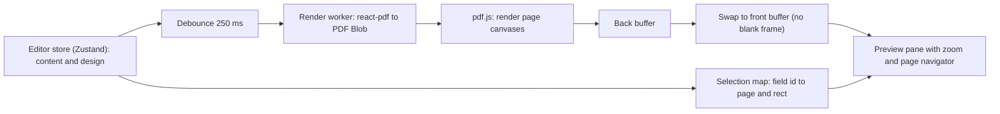

- **Why render the real PDF for preview:** preview ≡ export; pagination and fonts are exact. RR does the same with Forme + pdf.js [V]; CVTailor's two plans show the failure modes (blank flash per keystroke) and the fix (stable components + double buffering + cadence) [V].
- **Mitigations built in from day 1:** debounce; cancel stale renders (render token); keep the previous canvas visible until the next is ready; render only changed pages when possible; cap complexity; run in a Web Worker if Spike S1 shows main-thread jank.
- **Instant feedback for very fast typing:** the focused field shows its own value immediately in the edit panel; the preview catches up within ~0.5 s.
- **Selection sync:** the template reports bounding boxes per `item.id` (via react-pdf `render` callbacks or measured layout, **to be validated in Spike S1**); if infeasible with react-pdf, the feature is dropped from MVP (not a requirement).
- **Spike S1 (Phase 3, first week):** build the same template in `@react-pdf/renderer` and `@formepdf`; measure keystroke-to-pixel latency (target p95 ≤ 500 ms for 2 pages, including debounce), bundle size, text-extraction fidelity, font handling, and bounding-box support. Choose one. **Fallback F1:** HTML/CSS artboard preview (CVAurum-style) with the PDF generated by the chosen PDF engine, accepting small pagination drift and adding a "Check page breaks" button that renders the true PDF.

### 17.4 Editing behaviour

- Immutable updates through Immer; patches feed Zundo history; autosave sends the whole `content` + `design` (small, < 256 KB). JSON-Patch diffs (RR) are unnecessary at this size.
- Reordering: dnd-kit `SortableContext` per list with keyboard sensors; arrays reorder by id.
- Validation: Zod `safeParse` per field group; invalid drafts remain editable but are flagged and never block autosave of valid fields.
- Concurrency: optimistic `updated_at` check (§14.2); on conflict, show "Edited in another tab/device. Reload or keep mine".
- The editor lint (`Check` tab) imports the **same** `ats-engine` rules used for reports (single source of truth).

### 17.5 Fonts

Self-hosted TTF/WOFF files from `@fontsource`, registered with the PDF renderer by family+weight; subsetting is a Phase 3 optimisation (RR uses HarfBuzz WASM subsetting [V]; likely unnecessary for Latin-only MVP). Non-Latin scripts and RTL are **out of MVP scope** (RR supports bidi [V]; that is a large effort).

---

## 18. Export Architecture

| Format | Where generated | How | Notes |
|---|---|---|---|
| **PDF** | Browser (Web Worker) | Same pipeline as preview (§17.3), final render with embedded fonts, metadata (title, author), selectable text, tagged-PDF is *not* promised | CI test extracts text with `pdfjs` and asserts reading order, no missing glyphs (modelled on RR's `ats-extraction.integration.test.tsx` [V]) |
| **DOCX** | Browser | `docx` library builds a Word file from `content` + a *simplified* style mapping of `design` (fonts, colours, sizes, margins). Single-column, real Word styles (Heading 1/2, List Bullet), no tables or text boxes | Intentionally ATS-simple and editable in Word. Not a pixel copy of the PDF, so the UI says so. Pattern from RR `packages/docx` [V] |
| **JSON** | Browser | Envelope `{ app: 'ai-resume-builder', format_version, exported_at, schema_version, template_id, content, design }` | Import validates with Zod, enforces ≤ 512 KB, runs `migrate`, assigns fresh ids; never trusts embedded design values (clamped to ranges) |

Rules: no server-side copy is created during export; filenames sanitised (`[A-Za-z0-9._-]`); export errors are reported with a retry; a progress state appears for > 800 ms; DOCX/PDF are generated lazily (dynamic `import()`) to keep the initial editor bundle small.

**Post-MVP:** optional server export route for low-end devices, JSON Resume interoperability, plain-text export (an ATS-safe fallback many users want).

---

## 19. Project File Structure

Single Next.js app plus three framework-free workspace packages (pnpm workspaces). Chosen over a full Turborepo monorepo (RR) because there are only three packages and one app.

```
ai-resume-builder/
├─ apps/
│  └─ web/                           # the Next.js application (only deployable)
│     ├─ src/
│     │  ├─ app/                     # App Router: routes, layouts, route handlers
│     │  │  ├─ (marketing)/page.tsx  #   landing
│     │  │  ├─ (auth)/login|register|forgot-password|reset-password/
│     │  │  ├─ (app)/                #   authenticated shell
│     │  │  │  ├─ dashboard/ templates/ resumes/ resumes/[id]/edit|preview/
│     │  │  │  ├─ analyze/ analyze/[reportId]/ settings/
│     │  │  ├─ auth/callback/route.ts
│     │  │  └─ api/ analysis/route.ts account/delete/route.ts health/route.ts internal/purge/route.ts
│     │  ├─ modules/                 # feature modules (vertical slices)
│     │  │  ├─ auth/                 #   Supabase clients (browser/server/middleware), guards, forms
│     │  │  ├─ resumes/              #   queries, mutations, list UI, autosave, versions
│     │  │  ├─ editor/               #   store (zustand+zundo), panels, dnd, selection sync
│     │  │  ├─ templates/            #   registry + one folder per template + layout kit
│     │  │  ├─ preview/              #   render worker, pdf.js canvas, double buffer
│     │  │  ├─ export/               #   pdf.ts, docx.ts, json.ts, filenames
│     │  │  ├─ analysis/             #   upload UI, extraction worker, report UI, client for /api/analysis
│     │  │  ├─ account/              #   settings, deletion flow
│     │  │  └─ marketing/            #   landing sections
│     │  ├─ server/                  # server-only code
│     │  │  ├─ analysis-service.ts   #   orchestrates ats-engine + ai router + persistence
│     │  │  ├─ rate-limit.ts quota.ts
│     │  │  ├─ supabase-admin.ts     #   service-role client (imported by 2 files only)
│     │  │  └─ env.ts                #   Zod-validated environment
│     │  ├─ components/ui/           # shadcn primitives
│     │  ├─ lib/                     # small utilities (cn, dates, download)
│     │  ├─ styles/ tokens.css       # design tokens (§10)
│     │  └─ proxy.ts                 # session refresh + route protection (Next.js 16 name for middleware; on Next 15 a proxy.ts is never called [V])
│     ├─ public/                     # static assets (no resume data)
│     ├─ tests/ e2e/                 # Playwright specs
│     └─ next.config.ts tailwind.config.ts
├─ packages/
│  ├─ resume-schema/                 # Zod schemas, defaults, migrate(), sanitiser, types
│  ├─ ats-engine/                    # PURE: section detect, JD parse, scorers, rules, taxonomy, weights, report types
│  │  ├─ src/ rules/ scorers/ nlp/ taxonomy/skills.v1.json weights/
│  │  └─ test/ fixtures/             # golden resume/JD pairs
│  └─ ai/                            # AiProvider interface, router, adapters, prompts (versioned)
├─ supabase/                         # created in Phase 2 (NOT in Phase 1)
│  ├─ migrations/  seed.sql  tests/rls/
├─ docs/
│  ├─ PROJECT_BLUEPRINT.md  PHASE_1_REPORT.md
│  ├─ adr/  runbooks/  THIRD_PARTY_NOTICES.md  privacy-policy-draft.md
├─ .github/workflows/                # ci.yml (lint, typecheck, test, license-check, e2e)
├─ .env.example  pnpm-workspace.yaml  package.json  tsconfig.base.json
└─ README.md
```

| Directory | Responsibility | Dependency rule |
|---|---|---|
| `apps/web/src/app` | Routing, layouts, handlers only; thin | May import `modules`, `server` |
| `modules/*` | Each feature owns UI + hooks + client logic | May import `packages/*`, `components/ui`, `lib`; **not** other modules' internals (use their `index.ts`) |
| `server/` | Secrets-aware logic | Never imported by client components (enforce with `server-only` package + lint rule) |
| `packages/resume-schema` | Single definition of resume shape | No React, no Next, no Supabase |
| `packages/ats-engine` | Scoring and rules | **No network, no AI SDK, no React**; deterministic; the largest test surface |
| `packages/ai` | LLM access | Only place importing provider SDKs |
| `supabase/` | SQL and RLS tests | Phase 2 onward |
| `docs/adr` | Decision records (§27) | n/a |

Future expansion: a `packages/export-*` split, a mobile client reusing `resume-schema` and `ats-engine`, a worker service for server-side export, and a `jd-scraper` module, all possible without restructuring.

---

## 20. Security Architecture

### 20.1 Trust boundaries

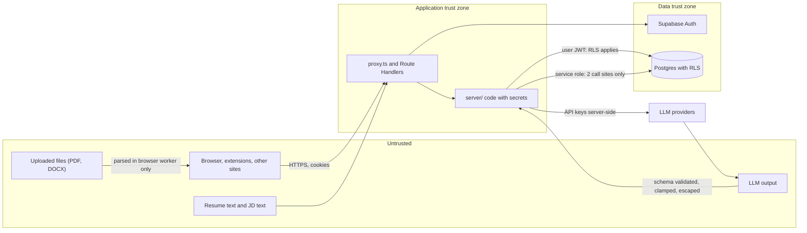

### 20.2 Requirements matrix

| Area | Threat | Requirement and implementation | Verification |
|---|---|---|---|
| **Authentication** | Credential stuffing, weak passwords, account enumeration | Supabase Auth; email confirmation required; minimum 8 characters, UI strength hint, no composition rules; neutral messages on login/reset ("Invalid email or password"; "If an account exists…"); Supabase's auth rate limits plus our own route limits; leaked-password protection is a Supabase feature whose plan availability is **[P]**, check (D6) | E2E tests for neutral errors; manual review of Supabase auth rate-limit settings |
| **Authorization** | Horizontal privilege escalation (IDOR, as found in CVTailor's `plans/004` [V]) | **RLS on every table**, default deny, per-operation policies, `with check` on writes; no reliance on client-supplied `user_id`; handlers use an RLS-bound client; service role confined to `account/delete` and `internal/purge` | pgTAP/two-user RLS suite in CI (§26, AC-SEC-1) |
| **OAuth (Google)** | Open redirect, code interception, mix-up | PKCE flow via Supabase; allow-listed redirect URLs only (production origin, preview wildcard on Vercel only if needed, localhost for dev); `next` parameter must be a same-origin relative path; scopes limited to `openid email profile` | Unit tests for `next` sanitiser; review of the Supabase redirect allow-list |
| **Session handling** | Session theft, fixation, stale/forged cookie | `@supabase/ssr` cookie sessions: `HttpOnly`, `Secure`, `SameSite=Lax`; short-lived access JWT with refresh rotation; **server authorization uses `getUser()`/`getClaims()`, never `getSession()`** [V]; token refresh happens in `proxy.ts` only (refreshing in both proxy and server components risks session revocation [V]); responses carrying auth cookies must not be CDN-cached (Supabase warning [V]); sign-out-all-sessions in Settings | Integration test: forged cookie rejected; cache-control headers asserted |
| **Database access** | Key leakage, over-privileged role | Anon key is public by design and safe only because of RLS; service-role key only in `server/supabase-admin.ts` (lint rule forbids other imports; `server-only` package); revoke default grants and re-grant minimally [V]; every `security definer` function sets `search_path = ''` [V] | CI grep/lint rule; pgTAP |
| **Row Level Security** | Policy gaps, performance cliffs | See §13.4; every new table ships with policies and tests (PR checklist) | `supabase test db` in CI |
| **File uploads** | Malicious files, oversized payloads, zip bombs | Default flow **does not upload**: file is parsed in a browser Web Worker. Client limits: ≤ 5 MB, `.pdf`/`.docx`, magic-byte check with `file-type` (not extension), PDF ≤ 15 pages parsed, wall-clock timeout 15 s, DOCX (zip) uncompressed size cap (e.g., 50 MB) and entry-count cap before handing to `mammoth`. If "keep original" is built later: server-side re-validation, private bucket, random object names, no public URL | Unit tests with crafted fixtures (zip bomb, renamed `.exe`, truncated PDF) |
| **PDF/DOCX parsing** | Parser exploits, DoS | Parsing happens client-side, so the blast radius is the user's own tab; extracted text is treated as plain untrusted text; the server **never** parses binary documents in MVP (ADR-012). Dependencies (`pdfjs-dist`, `mammoth`) pinned and updated promptly (pdf.js has had security advisories **[P]**, monitor) | Dependabot/`npm audit` in CI |
| **AI API keys** | Key exfiltration, abuse | Keys only in server env vars; never `NEXT_PUBLIC_*`; no bring-your-own-key in MVP (RR's encrypted saved providers [V] are deferred); per-user daily quota and burst limit; provider spend cap/alerts where available | Secret scanning (gitleaks) in CI; env schema forbids `NEXT_PUBLIC_` AI keys |
| **Rate limiting** | Brute force, scraping, quota exhaustion, free-tier AI drain | Per-user and per-IP fixed windows in `rate_limits` for `/api/analysis` (e.g., 5/min, 30/day) and AI quota in `ai_usage` (e.g., 3 AI runs/day); auth endpoints rely on Supabase limits + CAPTCHA option (Supabase supports CAPTCHA providers **[P]**) if abuse appears; `429` with `Retry-After` | Load test script; unit tests of limiter |
| **Input validation** | Injection, memory abuse | Zod at every boundary with explicit max lengths (JD ≤ 20,000 chars, resume text ≤ 60,000, body ≤ 1 MB); JSON import ≤ 512 KB and schema-validated; design values clamped to ranges | Property/fuzz tests on schemas |
| **XSS** | Stored XSS via resume fields, report text, AI output | React escaping by default; **no `dangerouslySetInnerHTML`** except a single sanitising component using DOMPurify with an allow-list (`b`, `i`, `a[href]`, `ul/li`); bullets stored as whitelisted markup, never raw HTML; link protocols allow-listed to `http`, `https`, `mailto`, `tel` (same set RR enforces [V]); `rel="noopener noreferrer nofollow"`; strict CSP (below); AI strings rendered as text | Playwright test injecting `` in every field; CSP report-only first |
| **CSRF** | Cross-site state change using cookie auth | `SameSite=Lax` cookies; state-changing handlers accept only `application/json`, verify `Origin`/`Sec-Fetch-Site` equals our origin, and require a custom header; Next.js Server Actions include origin checks **[P]**; no state change on `GET` | Tests for cross-origin POST rejection |
| **SQL injection** | Query tampering | No string-built SQL anywhere; PostgREST/`supabase-js` parameterise; SQL functions use typed parameters; no dynamic `EXECUTE` | Code review rule; static scan |
| **User data isolation** | Cross-tenant leaks via caching or shared state | RLS; per-request Supabase client (never a module singleton on the server) [V]; no user data in `unstable_cache`/ISR; `Cache-Control: private, no-store` on authenticated responses | Tests as above |
| **Resume privacy** | Unwanted exposure | All resumes private by default; **no public URLs in MVP**; report/resume ids are UUIDv4 but secrecy is not relied upon (RLS is) | AC-PRIV-* |
| **Prompt injection** | Resume/JD text instructing the model | See §16.6: delimited data, schema-constrained output, clamped deltas, no tool access, no HTML rendering of output | Adversarial fixtures in AI test suite |
| **Logging** | PII in logs | Structured logs with request id, user id (uuid), route, status, latency, provider/model, token counts; **never** resume text, JD text, prompts, emails, or tokens; error reporters configured to scrub bodies | Log-redaction unit tests; periodic log review |
| **Transport / headers** | Downgrade, clickjacking, sniffing | HTTPS everywhere, HSTS, `X-Content-Type-Options: nosniff`, `Referrer-Policy: strict-origin-when-cross-origin`, `frame-ancestors 'none'`, `Permissions-Policy` minimal | securityheaders-style test in CI |
| **Supply chain** | Malicious or GPL/AGPL dependency | Lockfile committed, `pnpm audit`, Dependabot, licence check failing CI on GPL/AGPL/unknown, minimal dependency set, no `postinstall` surprises (`--ignore-scripts` in CI where feasible) | CI gates |
| **Backups / recovery** | Data loss | Supabase free plan has **no automatic backups [V]** → scheduled `pg_dump` (GitHub Actions to private storage, encrypted) once the app holds real user data; restore drill documented | Runbook + quarterly drill |

**Content Security Policy (starting point; tune in Phase 7).** `default-src 'self'; script-src 'self' 'nonce-<random>'; style-src 'self' 'unsafe-inline'; img-src 'self' data: blob:; font-src 'self'; connect-src 'self' https://<project>.supabase.co; worker-src 'self' blob:; frame-ancestors 'none'; base-uri 'self'; form-action 'self'`. `blob:` workers are needed for the PDF render and parse workers. Roll out as `Content-Security-Policy-Report-Only` first.

### 20.3 Threat summary (STRIDE-lite)

| Threat | Most likely vector | Primary control |
|---|---|---|
| Spoofing | Forged session cookie | Server-side `getUser`/`getClaims` |
| Tampering | Edit another user's resume by id | RLS `with check` |
| Repudiation | Disputed deletion | Audit-free by design; deletion logged as event without content |
| Information disclosure | Cached authenticated response; logs; third-party LLM | `no-store`; log scrubbing; provider data-policy gate (§16.6, §21) |
| Denial of service | Large uploads, analysis spam, free-tier exhaustion | Size caps, rate limits, quotas, graceful degradation |
| Elevation of privilege | Service-role key leak | Two call sites, server-only, secret scanning, rotation runbook |

---

## 21. Privacy Strategy

> This section is engineering guidance, not legal advice. The owner is in India (₹ budget); processing personal data of people in India is, to my understanding, governed by the Digital Personal Data Protection Act, 2023, and EU/UK users would bring GDPR **[P: not verified in this phase]**. Obtain qualified legal review of the privacy policy, consent wording, and grievance contact before any public launch (D9).

### 21.1 Principles

1. **Minimise:** collect only what the feature needs (email, name, resume content the user types, JD text the user pastes).
2. **Process locally where possible:** file parsing, preview rendering, PDF/DOCX export, and JSON backup run in the browser.
3. **Do not keep what you do not need:** uploaded files are not stored; extracted text is not stored unless the user opts in; reports expire.
4. **Be explicit about third parties:** AI processing by an external provider is opt-in per run and names the provider.
5. **User control:** export everything, delete anything, delete the account.
6. **No secondary use:** user resumes are never used to train models, to build the calibration set (unless separately consented), or for marketing.

### 21.2 Data inventory and flows

| Data | Where it goes | Stored? | Retention | Third-party? |
|---|---|---|---|---|
| Email, name, password hash | Supabase Auth | Yes | Until account deletion | Supabase (processor); SMTP provider sees email address |
| Google profile (email, name, avatar URL) | Supabase Auth | Yes | Until deletion | Google (authentication) |
| Resume content/design | Supabase Postgres | Yes | Until deleted; versions capped; trash 30 days | Supabase |
| Uploaded file for analysis | Browser memory only | **No** | Session | None |
| Extracted resume text sent for analysis | Our server (in memory) → optional LLM | Only if `retain_text` | 90 days max | LLM provider only if user enabled AI |
| JD text | Our server → saved with report | Yes (needed to explain report) | 90 days | LLM provider only if AI enabled |
| Analysis report | Postgres | Yes (user may delete) | 90 days default | None |
| Usage counters | Postgres | Yes (aggregate) | 90 days | None |
| Request logs | Host platform | Yes (no content) | ≤ 14 days | Hosting provider |
| Cookies | Browser | Auth session only | Session/refresh | None |

### 21.3 Third-party LLM rules

- Local **Ollama = no third-party sharing**; default for self-hosting and dev.
- A cloud provider is allowed only if its terms, **checked and recorded in an ADR**, exclude training on and human review of submitted data. Gemini's *unpaid* tier fails this test: Google states it uses content to improve products and that human reviewers may read inputs and outputs, and tells users not to submit personal information [V]. Groq's and OpenRouter's data-retention terms were **not verified** in Phase 1, so both stay disabled until reviewed (D4).
- Before each AI-enabled run the UI shows: provider name, "your resume text will be sent to this provider", link to its policy; consent is remembered per provider and revocable.
- Redaction before sending: strip email, phone, street address, and profile URLs from the text sent to the LLM when the task does not need them (semantic relevance and grammar do not). This materially reduces exposure at low cost.

### 21.4 Avoiding unnecessary retention (mechanisms)

`expires_at` + purge job; `retain_text=false` default; no file storage by default; version caps; trash purge; cascade deletes; log scrubbing; no analytics that fingerprint users (use none in MVP, or a cookieless privacy-friendly option if later added); deletion verified by an automated test that creates a user with data in every table, deletes the account, and asserts zero rows remain.

### 21.5 User rights features (MVP)

Download all my data (JSON); delete a resume, version, report; delete account (two-step with typed email, recent re-auth); privacy page that matches reality (kept in `docs/privacy-policy-draft.md` and tested against §21.2 whenever a new data flow is added).

---

## 22. Deployment Architecture

### 22.1 Environments

| Environment | Runs | Data | Purpose |
|---|---|---|---|
| **Local** | `pnpm dev`; Supabase CLI local stack (Postgres, Auth, Studio, Inbucket mail catcher) in Docker; Ollama on the host | Disposable seed data | Daily development, RLS tests |
| **Preview** | Per-PR deployment on the host | Separate free Supabase project (staging) | E2E, design review |
| **Production** | Host + production Supabase project | Real | Beta users |

The two free Supabase projects (limit: 2 active [V]) are used as `staging` and `production`; local development needs none.

### 22.2 Deployment diagram

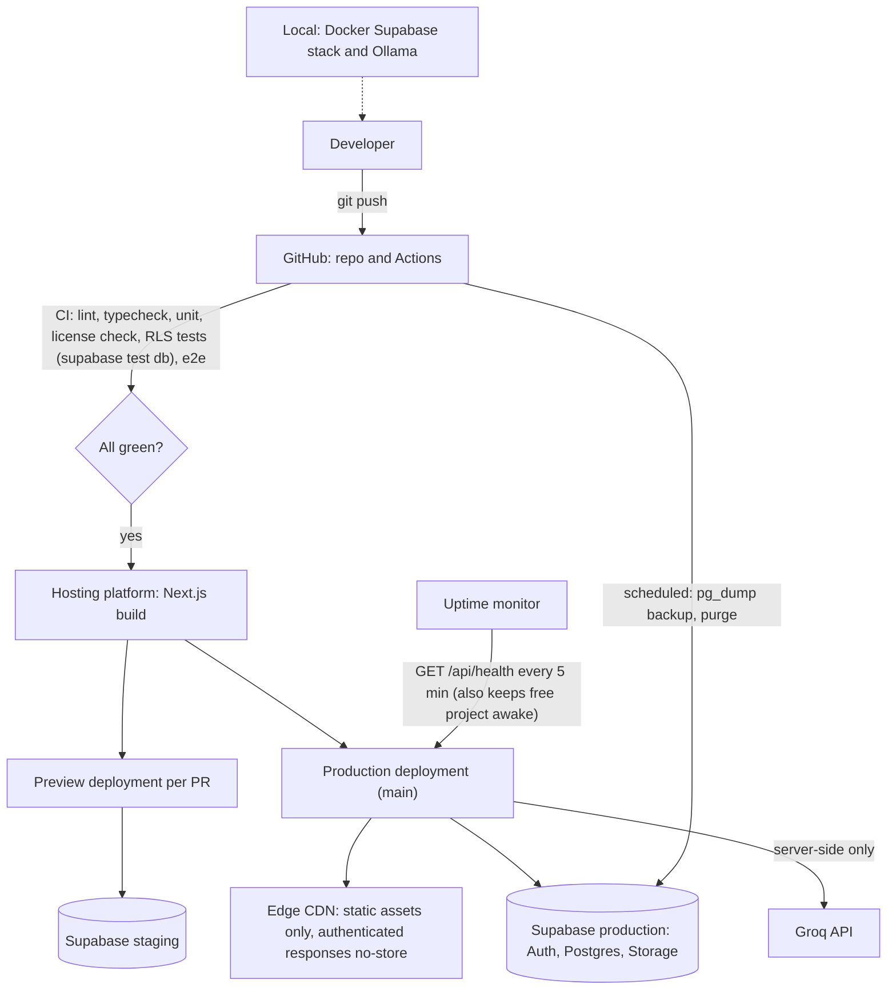

### 22.3 Hosting options

| Option | Fit | Constraints (verified unless marked) |
|---|---|---|
| **Vercel Hobby** | Best DX for Next.js. **Allowed only for personal, non-commercial use** [V]; "financial gain of anyone involved" in any part of production counts as commercial; donations do not. Included: 100 GB transfer, 1,000,000 function invocations, 4 h active CPU per month (fair-use guideline table) [V] | Fine for development, portfolio, a free closed beta with no monetisation. **Not** acceptable once you charge, run ads, or are paid to build it |
| **Vercel Pro** | Commercial use | Paid (~$20/user/month **[P]**, verify) |
| **Cloudflare Workers/Pages** | Free requests generous | Free plan: 100,000 requests/day, **10 ms CPU per request**, 50 subrequests [V per docs snippet]; the analysis route and any server-side parsing could exceed 10 ms CPU; Next.js on Workers needs an adapter **[P]** |
| **Self-hosted Docker (VPS or home server)** | Full control; ₹ cost = VPS | Next.js `output: 'standalone'` image; also matches RR's single-container deployment model [V] |

**Decision (ADR-011):** develop on Vercel Hobby for non-commercial pre-launch; keep the app host-agnostic (no Vercel-only APIs), so moving to Pro or Docker at monetisation is a configuration change.

### 22.4 Environment variables (names only)

| Variable | Scope | Notes |
|---|---|---|
| `NEXT_PUBLIC_SUPABASE_URL`, `NEXT_PUBLIC_SUPABASE_ANON_KEY` | public | Safe only because of RLS |
| `SUPABASE_SERVICE_ROLE_KEY` | server | Delete-account and purge only |
| `GROQ_API_KEY`, `OLLAMA_BASE_URL`, `AI_PROVIDER_ORDER`, `AI_DAILY_QUOTA` | server | Optional |
| `CRON_SECRET` | server | Authenticates purge |
| `APP_URL` | server | Allow-listed redirect base |
| `LOG_LEVEL` | server | |

All validated at boot by a Zod `env.ts`; the app refuses to start with a missing required value (and refuses any `NEXT_PUBLIC_` name that matches `*KEY*` except the anon key).

### 22.5 CI/CD gates

Lint, typecheck, unit tests (engine golden tests), RLS tests, dependency licence check, secret scan, build, Playwright smoke on preview, Lighthouse CI budget (Performance ≥ 85 on landing). Production deploy only from `main` after green checks; migrations applied through the Supabase CLI in a controlled step before deploy; every migration is backward-compatible for one release (expand/contract).

### 22.6 Observability and operations

Health endpoint, uptime ping, structured logs, error monitoring with body scrubbing (free tier, verify), a monthly "free-tier headroom" review (DB size, egress, AI tokens used vs limits), runbooks for: service-role key rotation, Supabase project paused/resumed, provider outage, restore from `pg_dump`.

---

## 23. MVP Cost Analysis

Target: **₹0 initially.** Figures are USD where vendors quote USD; no exchange-rate conversion is made because rates were not verified. Tags as in the header.

### 23.1 A. Completely free local development

| Item | Tool | Cost |
|---|---|---|
| Runtime, package manager | Node 24 LTS, pnpm | ₹0 |
| Containers | Docker Desktop (free for personal use **[P]**, verify licence terms if used commercially) or Podman | ₹0 |
| Backend stack | Supabase CLI local (Postgres, Auth, Studio, Inbucket) | ₹0 |
| Local AI | Ollama + a 7B/8B model on a 16 GB machine | ₹0 (needs ≥ 6 GB free RAM, disk ≈ 5 GB per model) |
| Editor/CI | VS Code, GitHub (free repos/Actions minutes) | ₹0 (Actions minutes limits **[P]**) |
| Design | Figma free or code-first | ₹0 |

### 23.2 B. Free-tier cloud deployment (non-commercial pre-launch)

| Service | Free-tier limits | Status | Implication |
|---|---|---|---|
| **Supabase Free** | 500 MB DB; 1 GB file storage; 5 GB egress (+5 GB cached); 50,000 MAU; 2 active projects; **paused after 1 week inactivity**; **no automatic backups** | **[V]** ([pricing](https://supabase.com/pricing)) | Needs keep-alive ping and own backups |
| Supabase Auth email | Built-in: 2 messages/hour, team members only | **[V]** | Custom SMTP required even for beta |
| **Vercel Hobby** | Personal non-commercial only; 100 GB transfer; 1M invocations; 4 h active CPU; 360 GB-hrs memory | **[V]** ([fair use](https://vercel.com/docs/limits/fair-use-guidelines)) | Must not carry monetisation |
| **Google OAuth** | Free for basic scopes | **[P]** | Configure consent screen |
| **Groq free** | Per-model RPM/TPM/day caps; shared across the whole app; 429 on exceed | **[R]** | §7.4 capacity maths: ≈ 110 (8B) or ≈ 22 (70B) analyses/day for *all* users |
| **Ollama** | Local only | **[V]** | Cloud users cannot use it |
| **GitHub + Actions** | Free for public/private within quotas | **[P]** | |
| **SMTP provider** | Not researched | **Unknown (D2)** | Must pick before beta |
| **Domain** | A custom domain is not free. A `*.vercel.app` subdomain is free | **[P]** | Defer purchase; OAuth consent screen looks better with a domain |
| **Monitoring** | Free uptime/error tiers exist | **[P]** | Verify quotas |

### 23.3 C. Services that may become paid with usage (tipping points)

| Trigger | What happens | Paid step | Rough cost |
|---|---|---|---|
| First revenue, ads, or paid contributors | Vercel Hobby no longer permitted [V] | Vercel Pro, or self-host | ~$20/user/month **[P]** or VPS cost |
| DB near 500 MB (see §23.4) or need backups/no-pause | Supabase Pro | $25/month per org **[R]** | |
| AI demand > free caps | 429s; degraded experience | Paid Groq/other tier, or paid-tier Gemini project, or hosted open-model API | Usage-based; not estimated |
| Email volume > SMTP free quota | Verification/reset delays | Paid SMTP tier | Unknown |
| Custom domain | Brand/OAuth consent trust | Domain registration | Unknown (registrar-specific) |
| Growth in MAU > 50,000 | Auth cost | Supabase Pro includes more **[R]** | |

### 23.4 Storage maths (assumption-driven; **measure in Phase 2**)

Let `S` = size of one resume's `content`+`design` JSON. Assume `S` ≈ 15 KB raw (typical 2-page resume with bullets) [assumption]. Worst case rows per resume = 1 current + 10 auto + 10 named versions = 21 × S ≈ **315 KB**; typical (≈ 5 versions) ≈ 90 KB. Postgres compresses large `jsonb` values (TOAST) so real figures should be lower **[P]**.

| Scenario | Per resume | Resumes that fit in 500 MB (ignoring indexes, auth tables, reports) |
|---|---|---|
| Worst case | 315 KB | ≈ 1,600 |
| Typical | 90 KB | ≈ 5,500 |

Reports add roughly 40 to 50 KB each (report JSON + 6 KB JD). 10 reports per active user adds ≈ 0.5 MB/user. Order-of-magnitude conclusion: **the free DB supports hundreds, not tens of thousands, of active users.** This is why version caps are 10+10 and reports expire at 90 days. The resume **list** must never `select content` (egress and DB I/O).

### 23.5 Summary

| Stage | Monthly cost |
|---|---|
| Development | ₹0 |
| Private/non-commercial beta (≤ a few hundred users) | ₹0 plus possibly SMTP and a domain (unknown) |
| Public with monetisation | Not ₹0: Vercel Pro (or VPS) + likely Supabase Pro + paid AI |

---

## 24. Development Roadmap

Effort figures are rough, solo-developer, unvalidated estimates for planning only.

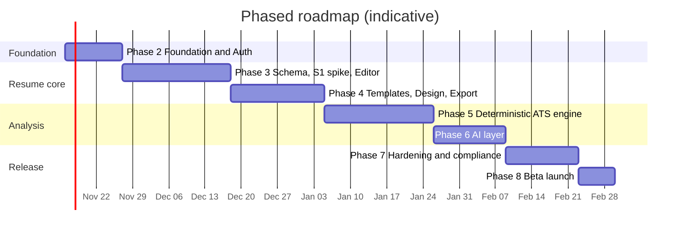

| Phase | Scope | Exit criteria |
|---|---|---|
| **2. Foundation and Auth** (~1.5 wk) | Repo, pnpm workspaces, CI, lint/format, design tokens + shadcn base, Supabase local + staging, migrations for `profiles`, RLS + pgTAP tests, auth flows (email, Google, reset), `proxy.ts`, landing/login/register/forgot pages, custom SMTP, env schema, licence/secret scan | A new user can register, verify, log in with Google/email, reset password, log out; RLS suite green; deletion test scaffolded; AC-AUTH-*, AC-SEC-1 pass |
| **3. Resume core and Editor** (~3 wk) | `resume-schema`, **Spike S1 (react-pdf vs Forme)** in week 1, store + undo/redo, left/center/right panes, first 3 templates, autosave + concurrency, versions, dashboard + My Resumes, thumbnails strategy | Create/edit/preview/save resumes with preview p95 ≤ 500 ms (2 pages); ADR-005 finalised |
| **4. Templates, Design, Export** (~2.5 wk) | 8 to 10 templates, design panel (fonts, colours, spacing, margins, page size), section reorder, template switching, PDF/DOCX/JSON export + import, extraction CI test, mobile editor layout | AC-EXP-*, AC-DES-*; PDF text extracts in correct order for every template |
| **5. Deterministic ATS engine** (~3 wk) | `ats-engine`: section detect, JD parser, taxonomy v1, scorers, rules, weights profile, explanations, report UI, `/api/analysis` (deterministic), upload worker, rate limits; **collect calibration set** (with consent) | AC-ANA-1..5; golden tests; explanations reproduce scores; calibration protocol written |
| **6. AI layer** (~2 wk) | `ai` package, router, Ollama + Groq adapters, prompts v1, enrichment, injection tests, quotas, evaluation harness, model choice for 16 GB | AC-AI-*; app fully works with AI off; evaluation report decides default models |
| **7. Hardening and compliance** (~2 wk) | Security review, CSP enforce, a11y audit (axe + manual keyboard/screen reader), perf budgets, privacy policy + legal review, backups, runbooks, load test, e2e suite | All release gates (§26.3) green |
| **8. Beta launch** (~1 wk) | Production Supabase, domain decision, monitoring, feedback channel, limited invite | Beta live; headroom dashboard reviewed weekly |

**Post-MVP candidates (not scheduled):** cover letters, public share links, OCR for scanned PDFs, passkeys/2FA, more locales and RTL, LinkedIn import, JD URL import, job tracker.

---

## 25. Technical Risks

### 25.1 Risk register

Likelihood (L) and Impact (I): H/M/L.

| ID | Risk | L | I | Mitigation | Owner phase |
|---|---|---|---|---|---|
| **R1** | **Live preview via real PDF render is janky/slow** (CVTailor needed two plans to cope [V]) | H | H | Spike S1 with latency budget; debounce + stale-render cancel + double buffer + worker; fallback F1 (HTML artboard + true-PDF check) | 3 |
| R2 | react-pdf layout limits (no CSS grid, limited text features) constrain template quality | M | M | Layout kit, design within primitives, S1 compares Forme; accept 8 to 10 conservative templates | 3, 4 |
| R3 | PDF text extraction order wrong in two-column templates, hurting ATS readability | M | H | Prefer single-flow content ordering in source, CI extraction tests per template, ship a "single column (ATS-safest)" variant | 4 |
| R4 | Free AI quotas exhausted by few users (§7.4 maths) | H | M | Deterministic-first; per-user quotas; caching; clear UX; local Ollama for self-hosters; plan paid tier | 5, 6 |
| R5 | **Unpaid LLM tiers use data for training/human review** (Gemini [V]) | H | H | Provider data-policy gate (§16.6), consent, redaction, Ollama; record in ADR-008 | 6 |
| R6 | Score viewed as authoritative/predictive; reputational and trust damage | M | H | Disclaimers, bands, transparency, calibration study, never claim employer-specific results | 5 |
| R7 | Scoring weights poorly calibrated or gameable | H | M | Revised model (§16.3), stuffing penalties, calibration set, versioned `engine_version`, A/B profiles | 5 |
| R8 | RLS misconfiguration leaks data | L | H | Default deny, per-op policies, pgTAP suite in CI, PR checklist, no `user_metadata` in policies | 2+ |
| R9 | Supabase free project pauses / DB fills / no backups [V] | H | M | Health-ping, storage caps, `pg_dump` job, upgrade trigger | 7, 8 |
| R10 | Vercel Hobby ToS violated on monetisation [V] | M | H | ADR-011; host-agnostic app; decision gate before any payment feature | 8 |
| R11 | Email deliverability (verification/reset) fails; default SMTP unusable [V] | H | H | Choose SMTP early (D2); test with real addresses; show resend UX | 2 |
| R12 | Resume parsing of uploaded PDFs unreliable (multi-column, tables, scans) | H | M | Geometry-based line assembly (RR's approach [V]), extraction-quality signals shown to user, paste fallback, OCR deferred | 5 |
| R13 | Template/design IP infringement | L | H | Original designs only; do not replicate competitor or RR template visuals; asset/font licences recorded | 4 |
| R14 | Licence contamination (copying AGPL/unlicensed code) | L | H | Clean-room rule for CVAurum/Resumix, licence CI check, `THIRD_PARTY_NOTICES.md` | all |
| R15 | Legal/privacy compliance gaps (DPDP/GDPR) | M | H | Data-minimisation design, legal review (D9) before public launch | 7 |
| R16 | Next.js/Supabase SSR cookie pitfalls cause random sign-outs [V] | M | M | Follow official pattern exactly (refresh only in `proxy.ts`), integration tests | 2 |
| R17 | Mobile editing UX is poor on small screens | M | M | One-pane-at-a-time design (§11.7.1), early device testing | 4 |
| R18 | Scope creep (RR has careers, MCP, mobile, etc. [V]) | H | M | Non-goals (§2.3), phase exit criteria | all |
| R19 | Bundle size too large (react-pdf + pdf.js + docx + tiptap) | M | M | Dynamic imports, workers, per-route code splitting, budgets in CI | 4 |
| R20 | Thumbnails for many resumes are slow/expensive | M | L | Lazy render, cache in IndexedDB keyed by `updated_at`, or small stored thumbnail (decide in Phase 3) | 3 |

### 25.2 Open decisions and unverified items

| ID | Decision / uncertainty | Recommended safe default | Needed by |
|---|---|---|---|
| D1 | PDF engine: react-pdf vs Forme (Spike S1) | react-pdf, switch only if S1 data demands | Phase 3 wk 1 |
| D2 | SMTP provider and its free quota (not researched) | Research 3 providers; pick one with custom-domain DKIM support | Phase 2 |
| D3 | Brand name, domain, and legal entity | Use a placeholder name; avoid names resembling competitors | Phase 8 |
| D4 | Groq / OpenRouter data-retention terms (not verified) | Groq cloud disabled for real user data until terms reviewed and recorded; Ollama for dev | Phase 6 |
| D5 | Exact current free-quota numbers for Groq/Gemini (conflicting third-party data) | Read provider consoles; design to degrade at any quota | Phase 6 |
| D6 | Supabase leaked-password protection and CAPTCHA availability on free plan | Rely on min length + rate limits; add CAPTCHA if abuse | Phase 2 |
| D7 | Skills taxonomy source and licence | Hand-built v1 (≈ 600 skills) from our own list; evaluate external datasets only after licence review | Phase 5 |
| D8 | Calibration data: sourcing real resumes ethically | Synthetic + volunteer-consented set; never user data without explicit separate consent | Phase 5 |
| D9 | Privacy/legal review (DPDP; GDPR if EU users) | Engage a qualified reviewer before public launch | Phase 7 |
| D10 | Monetisation intent (affects hosting and ToS) | Assume non-commercial beta until decided | Before Phase 8 |
| D11 | Rich text (Tiptap) vs plain textarea with markup shortcuts | Tiptap restricted; fall back to textarea if bundle/UX cost too high | Phase 3 |
| D12 | Selection sync (click preview → focus field) feasibility with react-pdf | Treat as optional; decide after S1 | Phase 3 |
| D13 | Competitor workflows are mostly [P]/[R] | One hands-on review pass (browser tool, with permission) | Phase 2 |
| D14 | Reactive Resume licence history not examined (depth-1 clone) | Re-check at the exact commit before copying any file | before any reuse |

---

## 26. Acceptance Criteria

### 26.1 Functional (testable)

| ID | Maps to | Criterion |
|---|---|---|
| AC-AUTH-1 | FR-AUTH-1 | Given a new email and valid password, when the user registers, then no session is granted until the emailed link is followed; after that the user lands on `/dashboard` and a `profiles` row exists |
| AC-AUTH-2 | FR-AUTH-2 | Given Google consent, when the callback completes, then the user is signed in, and a `next` value pointing off-origin is ignored |
| AC-AUTH-3 | FR-AUTH-3 | Given an unknown email on forgot-password, then the response is identical to a known email; a valid reset link sets a new password and invalidates the old one |
| AC-AUTH-4 | FR-AUTH-4 | Given account deletion confirmed with recent sign-in, then every row owned by the user in every table is gone (automated check) and login fails |
| AC-TPL-1 | FR-TPL-1 | At least 8 templates are listed with thumbnails; switching template keeps 100 % of content (deep-equal on `content`) |
| AC-RES-1 | FR-RES-1 | User can create, rename, duplicate, trash, restore, and permanently delete a resume; duplicate has a new id and identical content |
| AC-RES-2 | FR-RES-3 | After a keystroke, the preview reflects the change within 500 ms p95 (including debounce) for a 2-page resume on the reference laptop, and the previous page is never blank during update |
| AC-RES-3 | FR-RES-4 | Autosave persists within 3 s of the last change; reload shows the same content; concurrent edit in two tabs triggers the conflict prompt, not silent overwrite; undo/redo works for 100 steps |
| AC-RES-4 | FR-RES-5 | Sections and entries reorder by pointer and by keyboard; order persists and is reflected in preview and exports |
| AC-DES-1 | FR-DES-1 | Font, size, colours, spacing, margins, page size and columns can be changed; the preview and PDF both reflect them; invalid values are clamped |
| AC-EXP-1 | FR-EXP-1 | PDF downloads without server round-trip; text extracted with pdf.js contains all visible content in reading order for every template (CI) |
| AC-EXP-2 | FR-EXP-2 | DOCX opens in Word and LibreOffice without repair prompts; headings and bullets use real styles |
| AC-EXP-3 | FR-EXP-3 | Exported JSON re-imports to an identical `content`; malformed or oversized JSON is rejected with a clear message |
| AC-ANA-1 | FR-ANA-1 | PDF, DOCX and pasted text are accepted; files > 5 MB or wrong type are rejected before processing; a scanned PDF yields the "no text found" message |
| AC-ANA-2 | FR-ANA-2 | With AI off, a complete report is produced in < 2 s p95; each dimension shows formula id, inputs, contributions summing to the score, and evidence |
| AC-ANA-3 | FR-ANA-2 | Scoring is deterministic: identical inputs and `engine_version` give identical output (test) |
| AC-ANA-4 | FR-ANA-2 | Dimensions that do not apply are marked N/A and weights renormalise to 100 |
| AC-ANA-5 | §2.4 | Every report displays the estimate disclaimer and confidence level |
| AC-AI-1 | NFR-REL-1 | With every provider failing, the analysis still returns 200 with `scoring_mode = deterministic` and a notice |
| AC-AI-2 | FR-ANA-3 | LLM output failing schema validation is discarded; a score delta never exceeds the clamp; adversarial fixtures ("ignore previous instructions…") do not change scores beyond the clamp or leak the system prompt |
| AC-AI-3 | NFR-COST-1 | Per-user daily AI quota is enforced; the UI shows remaining runs and reset time |
| AC-UX-1 | FR-UX-1 | Editor is usable at 360 px width (Edit/Preview/Style switch) and at 1280 px (three panes); no horizontal scroll on any page at 360 px |

### 26.2 Non-functional and security

| ID | Criterion |
|---|---|
| AC-SEC-1 | For every table, a two-user test proves user B cannot select, insert-as, update or delete user A's rows; RLS is enabled on all tables (query `pg_tables`) |
| AC-SEC-2 | Service-role key appears in exactly the permitted modules (lint check) and never in client bundles (bundle grep) |
| AC-SEC-3 | Injected `<script>`/`` in every text field never executes in editor, preview, report or DOM exports |
| AC-SEC-4 | Cross-origin POST to state-changing routes is rejected |
| AC-SEC-5 | Authenticated responses carry `Cache-Control: private, no-store`; security headers and CSP present |
| AC-PRIV-1 | With `retain_text` off, `analysis_reports.resume_text` is null; no file object exists in storage after an upload analysis |
| AC-PRIV-2 | Logs sampled during an e2e run contain no resume text, JD text, email, or token |
| AC-PRIV-3 | Expired reports and old trash are purged by the job (test with shortened intervals) |
| AC-A11Y-1 | axe reports no serious/critical issues on all 12 pages; full keyboard operability including drag reorder alternative; contrast ≥ 4.5:1 for text |
| AC-PERF-1 | Landing LCP < 2.5 s on throttled mobile (Lighthouse CI); editor initial JS within the agreed budget |
| AC-OPS-1 | `/api/health` returns 200 only when the DB responds; backup and restore runbook executed once successfully |

### 26.3 Release gates

All AC items pass; CI green; licence report has no GPL/AGPL/unknown; secret scan clean; privacy policy reviewed (D9); decision D10 recorded; free-tier headroom reviewed; README + runbooks complete.

---

## 27. Architecture Decision Records

Status key: **Proposed** = recommended in Phase 1 and awaiting owner approval; **Verified** = rests on checked facts but still needs approval. Format: Context → Decision → Consequences.

**ADR-001: Single Next.js modular monolith.**
Context: solo MVP, ₹0, no need for independent scaling. Decision: one Next.js app + three pure packages; no microservices. Consequences: simple ops and deploy; must keep package boundaries disciplined (lint rule). Status: Proposed.

**ADR-002: Supabase for Auth, Postgres, Storage with RLS as the authorization layer.**
Context: user asked for Supabase; CVTailor's IDOR shows app-layer checks fail [V]. Decision: RLS default-deny; app uses RLS-bound clients; service role in two places. Consequences: coupling to Supabase SQL helpers (`auth.uid()`); free-tier operational limits [V] (pause, no backups, 2 projects, default SMTP). Status: Proposed (Verified facts).

**ADR-003: Resume = one validated JSON document with content/design split; sections not in their own table.**
Context: RR, CVAurum, CVTailor all use a document [V]. Decision: `resumes.content` and `.design` `jsonb`, Zod-validated, `schema_version` + migrations. Consequences: no SQL queries over section data (acceptable); easier undo/versions/export. Status: Proposed.

**ADR-004: Templates are code (registry + shared layout kit), not database rows.**
Context: avoids code/data drift. Decision: `template_id` text validated against registry. Consequences: new template = deploy; no user-created templates in MVP. Status: Proposed.

**ADR-005: One renderer (@react-pdf/renderer) for preview and PDF, validated by Spike S1; fallback F1.**
Context: preview = export; CVTailor and RR both settled on rendering the real PDF for preview [V]; flash risk documented [V]. Decision: react-pdf primary, Forme as evaluated alternative, F1 HTML preview fallback. Consequences: highest technical risk (R1); template CSS limits (R2). Status: Proposed, **pending S1**.

**ADR-006: Export and file parsing run in the browser.**
Context: free hosts limit CPU [V]; privacy. Decision: PDF/DOCX/JSON generation and PDF/DOCX text extraction in Web Workers; server receives text only. Consequences: no OCR; low-end devices may be slow (post-MVP server export option). Status: Proposed.

**ADR-007: Deterministic-first analysis; the LLM is optional and bounded.**
Context: free AI quotas tiny (§7.4); AI must be optional per brief. Decision: pure `ats-engine`; LLM adjusts within ±15 points of proxies and writes suggestions. Consequences: more engineering up front; reproducible, explainable scores. Status: Proposed.

**ADR-008: AI via Vercel AI SDK behind our `AiProvider` interface; provider data-policy gate.**
Context: 16 providers supported by AI SDK in RR [V]; Gemini unpaid tier trains/reviews data [V]. Decision: only providers with recorded no-training/no-human-review terms may receive resume/JD text; default cloud Groq pending D4, local Ollama. Consequences: smaller provider set; must verify terms. Status: Proposed.

**ADR-009: Revised scoring model (Job Match 80 % / ATS Readiness 20 %, N/A renormalisation, bounded LLM deltas).**
Context: §16.3 critique. Decision: adopt v1 weights, keep brief weights as `brief-v0` for comparison; calibrate before claims. Consequences: deviation from brief requires owner sign-off. Status: **Proposed, needs owner decision**.

**ADR-010: Authorization uses `getUser()`/`getClaims()`, never `getSession()`; refresh only in `proxy.ts`.**
Context: Supabase SSR docs [V]. Decision as stated. Consequences: extra network call for `getUser`; use `getClaims` where acceptable. Status: Verified.

**ADR-011: Host-agnostic app; Vercel Hobby only while non-commercial.**
Context: Hobby is non-commercial [V]. Decision: no Vercel-only APIs; decision gate before monetisation. Consequences: possible hosting migration. Status: Verified.

**ADR-012: No server-side parsing of binary documents and no OCR in MVP.**
Context: attack surface and CPU limits. Decision: browser-only parsing; scanned PDFs get guidance. Consequences: some users must paste text. Status: Proposed.

**ADR-013: Dark theme only in MVP; contrast-verified tokens.**
Context: brief's design direction; tokens checked (§10.2). Decision: ship dark only. Consequences: no light theme work; resume pages themselves remain white (print reality). Status: Proposed.

**ADR-014: Clean-room rule for reference repositories.**
Context: §6. Decision: no code from CVAurum (AGPL) or Resumix (unlicensed); MIT code only with attribution at a recorded commit; otherwise patterns only. Status: Verified.

---

## 28. References and Research Sources

### 28.1 Repositories studied (cloned 2026-11-02, depth 1)

- Reactive Resume: <https://github.com/reactive-resume/reactive-resume>. Key paths: `package.json`, `AGENTS.md`, `SECURITY.md`, `LICENSE`, `.env.example`, `packages/db/src/schema/resume.ts`, `packages/schema/src/resume/data.ts`, `packages/resume/src/ats/{catalog,rules,section-aliases}.ts`, `packages/pdf/src/forme/{reconciler,to-forme}.tsx`, `packages/pdf/src/templates/*`, `packages/docx/src/{builder,section-renderers}.ts`, `packages/import/src/{pdf-lines,docx-text}.ts`, `packages/ai/src/types.ts`, `packages/auth/src/{config,rate-limit}.ts`, `apps/web/src/features/resume/{editor/store.ts,preview/*,editor/design/*}`, `apps/web/src/features/ats-checker/*`, `tests/e2e`
- Resumix: <https://github.com/robindev2007/resumix>. `package.json`, `plan/PRODUCT_ROADMAP.md`, `src/features/ai-agent/tools.ts`, `src/scripts/export-pdf.ts`, `src/components/templates/*`, `src/types/resume.ts`
- CVTailor: <https://github.com/Kiranism/cvtailor>. `package.json`, `src/middleware.ts`, `src/server/{routers,services,db/schema}/*`, `src/server/services/{ai-model,ats-analysis}.ts`, `src/features/resume/templates/*`, `plans/001..005-*.md`, `LICENSE`
- CVAurum: <https://github.com/akhil-dara/CVAurum>. `LICENSE`, `NOTICE`, `package.json`, `docs/TEMPLATES.md`, `src/lib/ats.ts`, `src/templates/{registry.ts,_shared/Artboard.tsx}`, `src/lib/{docx.ts,pdf/}`

### 28.2 Official documentation consulted

- Supabase pricing: <https://supabase.com/pricing>
- Supabase Row Level Security: <https://supabase.com/docs/guides/database/postgres/row-level-security>
- Supabase custom SMTP: <https://supabase.com/docs/guides/auth/auth-smtp>
- Supabase Auth with Next.js (SSR): <https://supabase.com/docs/guides/auth/server-side/nextjs>
- Vercel fair-use guidelines: <https://vercel.com/docs/limits/fair-use-guidelines>
- Vercel Hobby plan: <https://vercel.com/docs/plans/hobby-plan>
- Gemini API terms: <https://ai.google.dev/gemini-api/terms>
- OpenRouter limits: <https://openrouter.ai/docs/api-reference/limits>
- Cloudflare Workers limits: <https://developers.cloudflare.com/workers/platform/limits/>
- npm registry (licence and version checks): <https://registry.npmjs.org/>

### 28.3 Competitor and market sources (third-party unless noted)

- FlowCV pricing (vendor): <https://flowcv.com/pricing>; review: <https://resufit.com/blog/flowcv-review-free-resume-builder-worth-trying/>
- Novoresume pricing (vendor): <https://novoresume.com/gb/pricing>; comparison: <https://novoresume.com/career-blog/novoresume-vs-kickresume>
- Kickresume: <https://www.kickresume.com/en/help-center/alternative-to-enhancv/>, <https://toolradar.com/tools/kickresume/pricing>, <https://www.resumecoach.com/reviews/kickresume-resume-builder-review/>
- Resume.io: <https://dupple.com/learn/best-free-ai-resume-builders>, <https://www.trustpilot.com/review/resume.io?page=6>, <https://pitchmeai.com/blog/resume-io-free-trial-tips>
- Rezi pricing (vendor): <https://rezi.ai/pricing>; independent review: <https://scoutify.com/blog/rezi-review/>
- Zety pricing (vendor, not directly verifiable): <https://zety.com/pricing>; review: <https://stylingcv.com/blog/zety-review-2026-features-pricing-pros-cons-worth-it-2/>
- Teal: <https://jobshinobi.com/compare/free-ai-resume-builder-vs-teal-free>, <https://www.resumecoach.com/reviews/tealhq-resume-builder-review/>
- Enhancv help (vendor): <https://help.enhancv.com/en/articles/1208865-what-is-included-in-the-free-version>; review: <https://resumehog.com/blog/posts/enhancv-review-late-2026-the-7-day-free-plan-pricing-and-ats-risks.html>
- Canva: <https://gptprompts.ai/canva-ai-resume-builder-review>, <https://resumegenius.com/reviews/canva-reviews>

### 28.4 AI provider and model sources (third-party; verify in consoles)

- Groq limits: <https://eesel.ai/blog/groq-pricing>, <https://costbench.com/software/llm-api-providers/groq/free-plan/>
- Gemini free-tier limits: <https://yingtu.ai/en/blog/google-gemini-api-free-tier>, <https://agentdeals.dev/gemini-api-pricing-changes>
- Ollama models for 16 GB: <https://serverman.co.uk/ollama/best-ollama-models-2026/>, <https://www.promptquorum.com/es/local-llms/top-open-source-models-ollama>

### 28.5 Method note and limits of this research

- Competitor products were **not** operated hands-on; most competitor facts are [R] or [P] and often conflict. Dollar figures in particular should not be reused without checking the vendor page.
- Mermaid diagrams were syntax-checked as described in `docs/PHASE_1_REPORT.md`.
- Items marked [P] come from general knowledge and were not re-verified.
